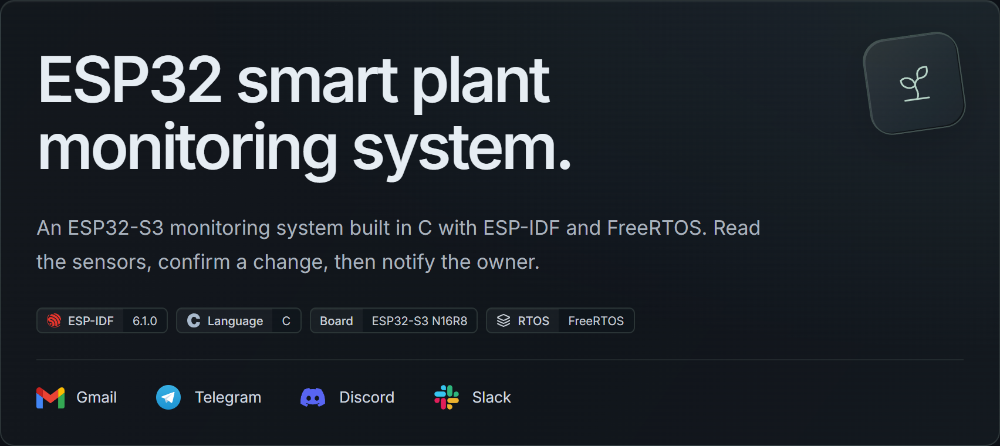
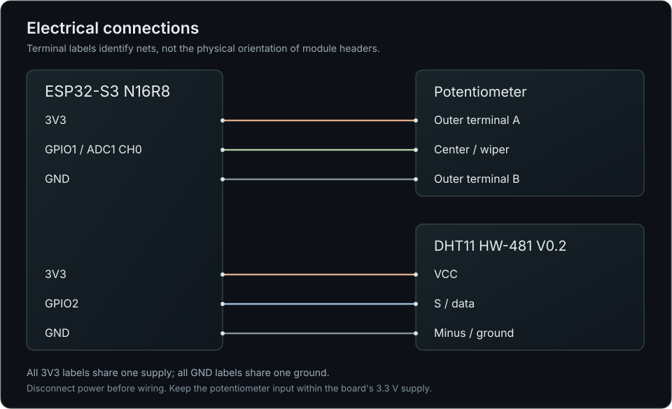
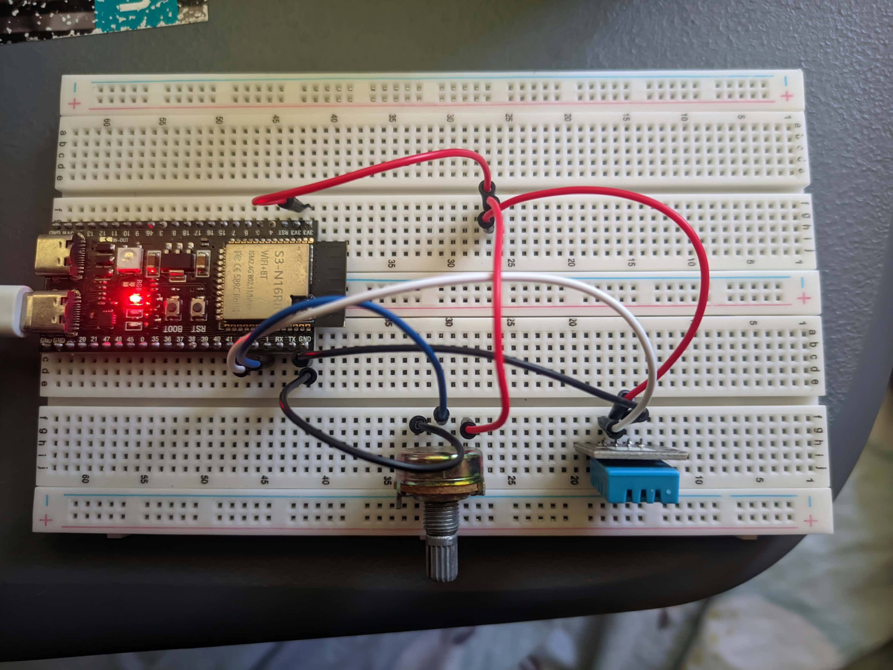
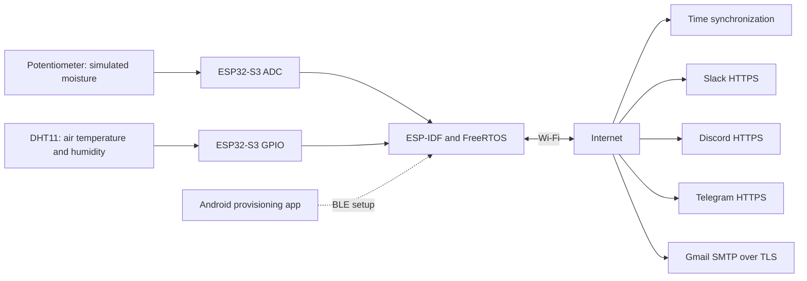
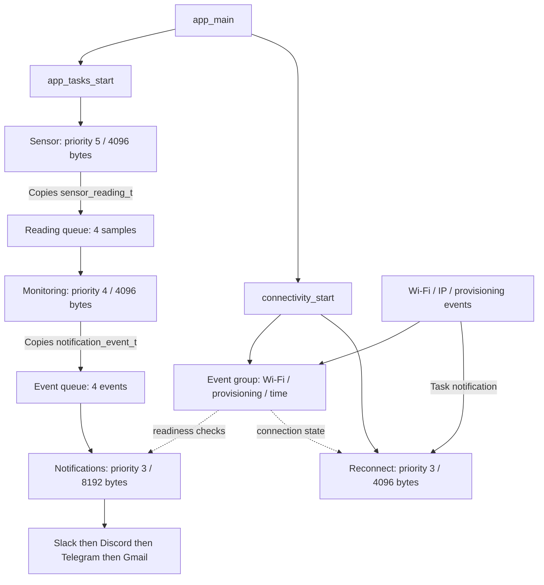
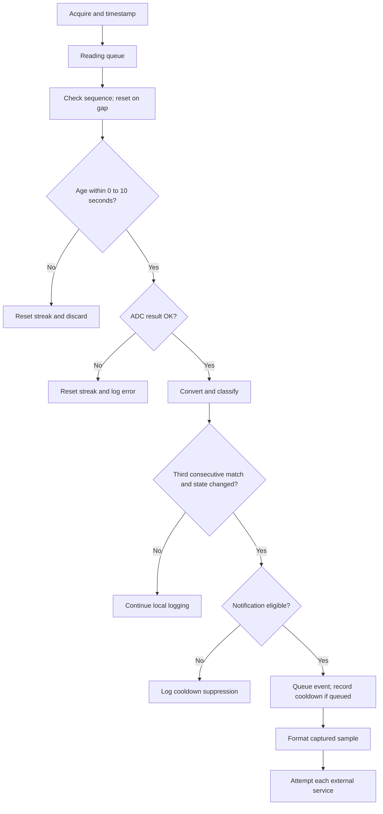
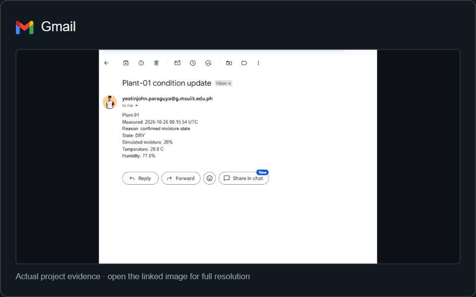
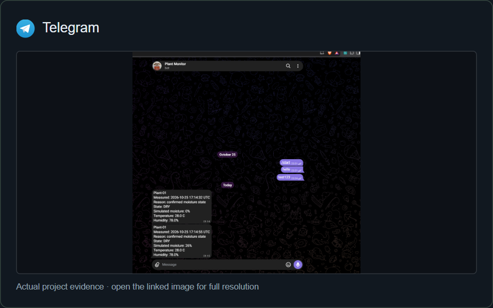
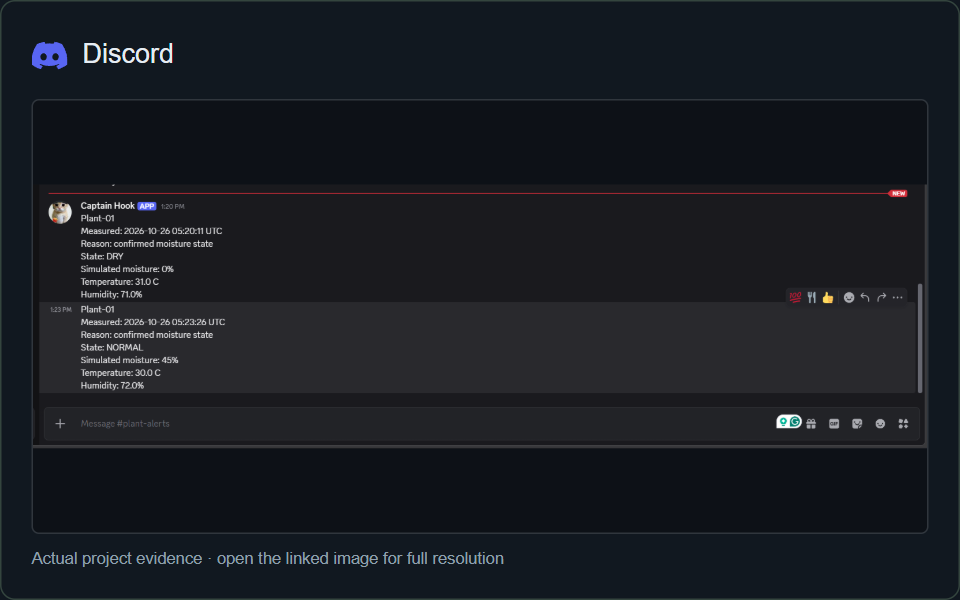
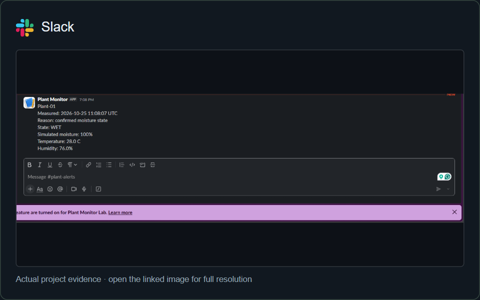

<p align="center">
  
</p>

# ESP32 Smart Plant Monitoring System

An ESP32-S3 reads a potentiometer and a DHT11 every five seconds, confirms changes in simulated moisture, and sends condition updates through four Internet services. Acquisition, monitoring, and delivery run in separate FreeRTOS tasks.

**BCA152 Microcontrollers · Project 1 · MSU–IIT**  
[Repository](https://github.com/xavieryyyyyy/esp32_smart-plant-monitoring-system) · [Development record](docs/progress.md) · [Test evidence](#verification) · [Submission checklist](#lab-requirements)

> **Hardware and channel adaptations**  
> A potentiometer simulates moisture; a DHT11 measures air temperature and relative humidity. The original brief specifies a capacitive soil sensor, DHT22, Gmail, WhatsApp, Telegram, and X. This implementation uses Gmail, Telegram, Discord, and Slack. The builder reports instructor permission for these adaptations. Simulated moisture is not soil calibration, and the substituted channels are identified throughout this guide.

<a id="contents"></a>
## Contents

[Overview](#overview) · [Hardware](#hardware) · [Wiring](#wiring) · [Build and configuration](#setup) · [Architecture](#architecture) · [Sensor and notification policy](#policy) · [Wi-Fi setup](#wifi) · [Service setup](#integrations) · [Security](#security) · [Verification](#verification) · [Delivery gallery](#gallery) · [Lab requirements](#lab-requirements) · [Repository map](#repository-map) · [Troubleshooting](#troubleshooting) · [Known limits](#limitations) · [Development history](#history) · [References](#references)

<a id="overview"></a>
##  Project overview

The potentiometer makes dry, normal, and wet input levels repeatable on the bench without a soil sensor. The DHT11 supplies independent environmental readings. The firmware is written in C using **ESP-IDF**, including its integrated FreeRTOS implementation. It does not use Arduino, `setup()`, or `loop()`.

No external application server, MQTT broker, cloud database, custom mobile app, or irrigation controller is part of this implementation.

| Behavior | Current implementation |
|---|---|
| Acquisition period | 5 seconds with `vTaskDelayUntil()` |
| Input conversion | 12-bit ADC raw value mapped to a simulated 0–100% index |
| States | DRY below 30%; NORMAL from 30–70%; WET above 70% |
| Confirmation | 3 consecutive matching, valid, fresh ADC readings |
| Monitoring freshness | Reject samples older than 10 seconds or with future timestamps |
| Repeated-alert cooldown | 15 minutes independently for DRY and WET |
| Network setup | Phone-to-ESP32 BLE provisioning; credentials retained in NVS |
| Dispatch order | Slack, Discord, Telegram, then Gmail, sequentially |
| Time display | UTC measurement time captured at acquisition start |
| Quality checks | Six monitoring tests reported passing; clean build; Cppcheck review |

The assembly photograph is included below. The final report, demonstration video, and several fault-path checks remain open. The [requirement matrix](#lab-requirements) records these gaps; this README does not claim complete lab acceptance.

<a id="hardware"></a>
##  Hardware and environment

| Item | Purpose | Details |
|---|---|---|
| ESP32-S3 N16R8 development board | Firmware, Wi-Fi, BLE | Module designation: 16 MB flash and 8 MB PSRAM; PSRAM operation unverified |
| Three-terminal potentiometer | Simulated moisture | Outer terminals across 3V3/GND; center wiper to GPIO1 |
| DHT11 HW-481 V0.2 module | Air temperature and humidity | Check the actual S/VCC/minus labels |
| Breadboard and jumper wires | Connections | All devices share ground |
| USB data cable | Power, upload, serial console | COM10 used during development; use your computer's port |
| Android phone | First-time provisioning | Espressif ESP BLE Provisioning app |
| Wi-Fi and Internet connection | Time and service requests | Network must support the ESP32-S3's 2.4 GHz Wi-Fi |

### Recorded build environment

| Tool or setting | Observed value |
|---|---|
| PlatformIO Core | 6.2.0 |
| PlatformIO Espressif32 platform | 7.1.2 |
| ESP-IDF | 6.1.0 |
| Xtensa toolchain package | `15.2.0+20251204` |
| Base board profile | `esp32-s3-devkitc-1` |
| Framework | `espidf` |
| Serial console | 115200 baud |
| Flash configuration | 16 MB |
| Factory app partition | 4 MB |

`platformio.ini` currently uses the unpinned platform identifier `espressif32`. These recorded versions aid reproduction; they do not guarantee that a fresh installation resolves the same tools. Managed-component versions and hashes are in [dependencies.lock](dependencies.lock).

The base profile may be described as N8 / 8 MB / no PSRAM in PlatformIO output. It is a base profile, not identification of the physical module. Flash size is overridden in this project. No verified PSRAM-use claim is made.

<a id="wiring"></a>
##  Wiring

Disconnect USB power before changing connections. Follow the actual GPIO labels rather than the position of a pin in a photograph of another board.

| Terminal | ESP32-S3 | Firmware mapping |
|---|---|---|
| Potentiometer outer terminal A | 3V3 | Supply end |
| Potentiometer center / wiper | GPIO1 | `ADC_UNIT_1`, `ADC_CHANNEL_0` |
| Potentiometer outer terminal B | GND | Ground end |
| DHT11 S | GPIO2 | `GPIO_NUM_2` |
| DHT11 VCC | 3V3 | Supply |
| DHT11 minus | GND | Common ground |



The drawing shows electrical connections, not physical board pin positions. DHT module layouts vary. The code enables GPIO2's internal pull-up; the module's external pull-up was not independently measured.

If knob direction is reversed, swap only the potentiometer's two outer supply connections with power disconnected. Keep the center connected to GPIO1. Left-decreases/right-increases was discussed, but a separate direction acceptance test was not recorded.

### Assembled prototype

<p align="center">
  <a href="docs/images/hardware-setup.jpg"></a>
</p>

The actual bench assembly uses the ESP32-S3 N16R8, a rotary potentiometer, and the DHT11 module. Open the photo for full resolution. Refer to the electrical diagram and pin table for individual connections; some terminal labels are obscured in the photograph.

<a id="setup"></a>
##  Build and configure

### 1. Open the project root

Use VS Code with PlatformIO and Git. The first build may download the toolchain and managed components. Commands below are for a PowerShell/PlatformIO terminal.

```powershell
git clone https://github.com/xavieryyyyyy/esp32_smart-plant-monitoring-system.git
cd esp32_smart-plant-monitoring-system
```

Open the folder containing `platformio.ini`, `src/`, and `components/`. The original local folder was named `plant-monitor`; the clone's folder name does not need to match it.

### 2. Create the private configuration

When `config.local.h` does not already exist, copy the example once:

```powershell
Copy-Item components/notifications/config.example.h components/notifications/config.local.h
```

Edit the local file; keep the example sanitized:

```c
#pragma once

#define SLACK_WEBHOOK_URL "https://hooks.slack.com/services/REPLACE_ME"
#define DISCORD_WEBHOOK_URL "https://discord.com/api/webhooks/REPLACE_ME"
#define TELEGRAM_BOT_TOKEN "REPLACE_ME"
#define TELEGRAM_CHAT_ID "REPLACE_ME"
#define GMAIL_ADDRESS "REPLACE_ME@gmail.com"
#define GMAIL_APP_PASSWORD "REPLACE_ME"
#define GMAIL_RECIPIENT "REPLACE_ME@gmail.com"
```

Replace all seven values using [service setup](#integrations). The header is required to compile the notifications component. Placeholders cannot deliver messages. Wi-Fi credentials are sent from the phone, not placed in this header.

```powershell
git check-ignore components/notifications/config.local.h
```

Expected output: `components/notifications/config.local.h`.

### 3. Check configuration

```ini
[env:esp32-s3-devkitc-1]
platform = espressif32
board = esp32-s3-devkitc-1
framework = espidf
monitor_speed = 115200
board_upload.flash_size = 16MB
board_build.partitions = partitions.csv
extra_scripts = pre:scripts/refresh_component_cmake.py
test_framework = unity
test_build_src = no
```

The tracked `sdkconfig.esp32-s3-devkitc-1` includes the settings below. Use `pio run -t menuconfig` for configuration changes.

```ini
CONFIG_ESPTOOLPY_FLASHSIZE_16MB=y
CONFIG_BT_NIMBLE_ENABLED=y
CONFIG_ESP_PROTOCOMM_SUPPORT_SECURITY_VERSION_1=y
CONFIG_MBEDTLS_CERTIFICATE_BUNDLE=y
CONFIG_MBEDTLS_CERTIFICATE_BUNDLE_DEFAULT_FULL=y
CONFIG_MBEDTLS_CERTIFICATE_BUNDLE_CROSS_SIGNED_VERIFY=y
CONFIG_MBEDTLS_HAVE_TIME_DATE=y
```

Flash capacity and application capacity differ. [partitions.csv](partitions.csv) reserves NVS at `0x9000`, PHY data at `0xf000`, and a 4 MB factory app at `0x10000`. The earlier 1 MB app slot was too small after BLE support was added. This table has no OTA update slots.

### 4. Build, upload, and monitor

```powershell
pio run
pio device list
pio run -t upload
pio device monitor
```

If automatic port detection fails, substitute your board's port:

```powershell
pio run -t upload --upload-port COM10
pio device monitor --port COM10 --baud 115200
```

PlatformIO's Build checkmark compiles; Upload writes the board. Exit the monitor with **Ctrl+C** if it holds the port. Compilation, boot, sensor operation, and recipient delivery are separate checks.

<a id="architecture"></a>
##  Architecture and data ownership

### System block diagram



### Task diagram



| Task | Responsibility | Scheduling |
|---|---|---|
| Sensor | Initializes ADC/DHT; timestamps and acquires samples | `vTaskDelayUntil()`, five-second period |
| Monitoring | Checks sequence/age, classifies, confirms, evaluates cooldown | Blocks on reading queue |
| Notification | Formats one captured event; attempts each service | Blocks on event queue; networking runs here |
| Reconnect | Retries station association using stored credentials | Task notifications and backoff up to 30 seconds |

Stack allocations are ESP-IDF bytes, not measured headroom. Higher sensing priority gives it precedence over monitoring/network work; this is not a measured hard real-time guarantee. Tasks are not explicitly pinned to cores.

The sensor task owns hardware access. Queue sends copy structures by value, so a later acquisition cannot overwrite a queued sample. Each sample carries sequence, monotonic acquisition time, optional UTC time, ADC/DHT results, and values. Notification events copy the sample and an eight-byte state string. Monitoring owns its state/cooldown object. Only the notification task calls senders; Slack's static retry state relies on this single-caller design.

Both queues use nonblocking sends: a full queue logs a warning and drops the new item. A later sequence gap resets confirmation. Dropped notification transitions are not automatically replayed.

### Processing flow



DHT health is independent from ADC validity. A DHT timeout does not invalidate a valid moisture observation; its notification reports temperature/humidity as unavailable. A stale sample is discarded before either sensor is processed.

<a id="policy"></a>
##  Sensor and notification policy

### Conversion and thresholds

```text
simulated_percent = (raw × 100) / 4095
```

The ADC uses 12-bit readings and 12 dB attenuation. Integer division truncates the result: 0 maps to 0%, 4095 to 100%. This is not a calibrated voltage, knob angle, or soil water percentage; endpoint saturation is possible.

| Index | State | Demonstration meaning |
|---|---|---|
| Below 30% | DRY | Low input |
| 30–70%, inclusive | NORMAL | Middle input; recovery state |
| Above 70% | WET | High input |

Stationary raw ranges of 3345–3355 and 1814–1819 were observed at two positions. No smoothing was added. Thresholds were selected for bench demonstration, not a particular plant. A future real-sensor calibration must measure dry/wet soil endpoints, establish response direction, derive an index, and repeat threshold/fault tests. Those soil measurements have not been performed.

### Validation

- ADC errors preserve the driver result; successful values must lie within 0–4095.
- DHT errors preserve the driver result; successful temperature/humidity must be finite, and humidity must lie within 0–100%.
- Caller outputs update only after success and validation.
- Temperature finiteness is checked, but a DHT-specific physical temperature-range check is not implemented.
- Monitoring rejects future acquisition timestamps or age above 10 seconds. Exactly 10 seconds is accepted by the comparison but not separately tested.
- ADC errors, stale rejection, and sequence gaps break the confirmation streak.

An in-range ADC value does not prove that the potentiometer is connected. Freshness is checked at monitoring, not again before each external delivery.

### Confirmation, initial report, and recovery

The confirmed state starts as `UNKNOWN`. Three matching valid readings establish the initial state and queue an eligible first event. Later confirmed changes produce further events. This uses consecutive readings rather than separate entry/exit hysteresis bands.

At a five-second period the first-to-third sample span is about ten seconds. The initial two-second sensor delay explains confirmations near 12.5 seconds in recorded runs.

DRY and WET each have a 15-minute cooldown; NORMAL recovery remains eligible. The default is initialized in `monitoring_init()` as `15LL * 60LL * 1000000LL`. It is a field of `monitoring_t`, not a phone setting.

Cooldown starts on successful **enqueue**, not completed recipient delivery, and resets on reboot. Holding a state does not produce periodic reminders. Suppressed transitions are not automatically retried when cooldown expires. Failed events are not stored durably or replayed on reconnect.

### Message contents

The healthy-DHT formatting branch uses this structure; the values illustrate the format rather than a new test:

```text
Plant-01
Measured: 2026-10-26 00:15:54 UTC
Reason: confirmed moisture state
State: DRY
Simulated moisture: 26%
Temperature: 28.0 C
Humidity: 77.0%
```

Measurement UTC is captured at acquisition start. If time was not synchronized then, the healthy-DHT branch labels it unavailable. The current failed-DHT branch reports `Temperature/humidity: unavailable` but omits the `Measured` line; this is a message-completeness gap.

Initial, alert, and recovery messages currently share the generic reason string. Separate reason labels and periodic summaries are not implemented. Formatting uses a 384-byte buffer; truncation/errors cause a logged drop.

<a id="wifi"></a>
##  Wi-Fi, BLE provisioning, and time

BLE configures Wi-Fi; it does not deliver Internet notifications. The ESP32 runs NimBLE and Espressif `network_provisioning`, using security version 1 and a generated proof-of-possession code.

### First connection

1. Upload the application and open the monitor.
2. On an unprovisioned board, find the logged device name beginning `PROV_PLANT_`.
3. Open **ESP BLE Provisioning** on Android, allow its required Bluetooth permissions, and select the device.
4. Enter the private setup code shown in the monitor. Do not include it in public screenshots.
5. Select Wi-Fi and send credentials.
6. Confirm IP acquisition, credential acceptance, and setup completion. BLE provisioning ends and its configured cleanup releases Bluetooth memory.
7. Wait for `TIME: Clock synchronized` before expecting service requests.

The current workflow uses the printed name/code, not a generated QR code. Provisioning credential failure allows another setup attempt.

### Saved connections and recovery

NVS retains credentials after restart. The provisioned path starts station mode without onboarding. Wi-Fi event handlers and task notifications drive retries at 1, 2, 4, 8, 16, then up to 30-second delays. Temporary disconnects do not require restarting the board.

The [device-originated disconnect test](docs/results/wifi-reconnection-test.md) reacquired IP about 4.83 seconds after disconnection. The shared router was not changed. Router outage, prolonged unavailability, and sensing continuity during the exact disconnected interval are not proven by that excerpt.

SNTP uses `pool.ntp.org`; synchronization sets the time-ready flag. All sender functions check network/time readiness. An event dispatched before readiness can fail and is not automatically replayed; generate a new confirmed transition after readiness.

**Changing Wi-Fi credentials:** no user-facing reset/reprovision command is implemented. Rebooting does not erase saved credentials. A controlled reset procedure still needs implementation/verification; full flash erase is not a normal demonstration step.

<a id="integrations"></a>
##  Service setup

| Service | Role | Credentials | Firmware acceptance check |
|---|---|---|---|
|  Gmail | Email record | Address and app password | Expected SMTP codes, including post-DATA `250` |
|  Telegram | Personal bot alert | Token and chat ID | HTTP `200` plus JSON `ok: true` |
|  Discord | Channel update | Webhook URL | HTTP `200` with `wait=true` |
|  Slack | Workspace update | Webhook URL | HTTP `200` |

Requests originate on the ESP32; no paid relay is configured. Provider eligibility, limits, and future pricing remain provider-controlled; this guide does not promise unlimited free service. Only Slack has a retry loop. Failure in one sender is logged and later senders are still attempted.

<details>
<summary><strong>Gmail account setup and SMTP flow</strong></summary>

1. Use a Google account eligible for app passwords and enable 2-Step Verification where required.
2. Create an app password for this device. Work/school policies may prevent this; see [Google's account guidance](https://support.google.com/accounts/answer/185833).
3. Set `GMAIL_ADDRESS`, the 16-character `GMAIL_APP_PASSWORD` without display spaces, and `GMAIL_RECIPIENT` in the private header.
4. Sender/recipient may be the same account for testing; they remain separate fields.
5. Trigger an event and compare the actual inbox message with its device log.

The sender uses immediate TLS at `smtp.gmail.com:465`, then `EHLO`, `AUTH LOGIN`, `MAIL FROM`, `RCPT TO`, `DATA`, and `QUIT`. MIME body transfer is Base64; Base64 is encoding, while TLS encrypts the connection. The email `Date` header is submission time; the message body carries acquisition time when the healthy-DHT branch is used.

Codes `235` and post-DATA `250` were observed, followed by inbox delivery. SMTP acceptance alone is not inbox proof. Account password changes may revoke app passwords. OAuth refresh, Gmail retries, and delivery receipts are not implemented.

</details>

<details>
<summary><strong>Telegram bot and chat ID</strong></summary>

1. Open the verified `@BotFather`, use `/newbot`, and save the token privately.
2. Open the new bot, send `/start`, then a fresh message.
3. Read `message.chat.id` from the bot's `getUpdates` response. If empty, send another fresh message. Do not publish token-bearing URLs or private response data.
4. Set `TELEGRAM_BOT_TOKEN` and the quoted `TELEGRAM_CHAT_ID` in the local header.
5. Trigger an event and inspect the recipient chat.

See the official [bot guide](https://core.telegram.org/bots/features#botfather) and [Bot API](https://core.telegram.org/bots/api).

The sender posts JSON `chat_id` and `text` to `sendMessage`. It bounds the response buffer to 4096 bytes, detects overflow, parses JSON, and requires `ok: true`. The token is in the API URL and must not appear in diagnostics. This firmware does not implement inbound commands or replies; `/start` establishes the recipient conversation.

</details>

<details>
<summary><strong>Discord incoming webhook</strong></summary>

1. In a channel/server you control, create an incoming webhook in its integration settings.
2. Set `DISCORD_WEBHOOK_URL` to the plain `https://discord.com/api/webhooks/...` URL, without query parameters or a fragment.
3. The firmware appends `?wait=true`; trigger an event and check its channel.

JSON uses `content` and disables automatic mention parsing with `allowed_mentions`. No separately hosted bot is needed. HTTPS uses a 10-second configured client timeout and disables automatic redirects. See [Discord's webhook reference](https://docs.discord.com/developers/resources/webhook).

</details>

<details>
<summary><strong>Slack incoming webhook and retry policy</strong></summary>

1. Create an app for your Slack workspace.
2. Enable Incoming Webhooks, add a workspace webhook, and authorize its channel.
3. Set `SLACK_WEBHOOK_URL` to the generated `https://hooks.slack.com/services/...` URL.
4. Trigger a confirmed event and inspect the channel.

Only the webhook is used: Slack CLI, Bolt, Socket Mode, bot events, and bot tokens are unnecessary for this path. See [Slack's incoming-webhook guide](https://docs.slack.dev/messaging/sending-messages-using-incoming-webhooks/).

The sender posts JSON `text` with up to three attempts. Selected temporary errors use roughly two- then four-second waits. A `429` uses a numeric `Retry-After`; a missing/invalid value pauses Slack until restart. A required wait above the 30-second waiting budget abandons that event while retaining the deadline. This is not a total transaction deadline.

Controlled 503/429 injections tested attempt limits and delays, not real header parsing. Ambiguous transport retries may duplicate delivery. HTTP 200 is checked, but the body is not independently required to equal `ok`.

</details>

<a id="security"></a>
##  Security and error handling

All senders attach ESP-IDF's root certificate bundle. Date checking is enabled and sends require synchronized time. Full-bundle/cross-signed support was enabled without disabling certificate verification.

| Area | Implemented | Limit |
|---|---|---|
| Credentials | Ignored private header, sanitized example; Wi-Fi in NVS | Secrets compiled into firmware; encrypted storage and secure boot unverified |
| Time | SNTP gate, captured UTC measurement time | No readiness-triggered replay or independent clock calibration |
| TLS | Root bundle and certificate date checking | Invalid-date certificate rejection not tested |
| HTTPS | 10-second configured client timeout; no automatic redirects | Not a guaranteed total dispatch deadline |
| SMTP | Verified TLS, expected reply codes, bounded reply processing | Multi-command session can exceed one client timeout |
| Retries | Slack attempt limit and rate-delay logic | Other channels lack retry loops |
| Queue pressure | Fixed capacities and logged drops | No durable queue, replay, or overflow experiment |
| Sensor errors | Independent result codes; failed DHT values not used | Finite implausible temperature and in-range wiring faults can pass |

The BLE proof-of-possession code is printed for local setup and remains private. Exclude it, tokens, passwords, full credential URLs, and private recipient identifiers from public evidence. Compiled firmware contains configured secrets and is not a sanitized release artifact. Git ignore rules do not remove secrets already committed.

<a id="verification"></a>
##  Verification and acceptance evidence

These records distinguish hardware observations, controlled fault injection, and pending checks. API acceptance and visible recipient delivery are separate evidence.

### T1–T8 from the brief

| Case | Required behavior | Evidence and current result | Status |
|---|---|---|---|
| T1 Startup/sensing | Periodic sensors, units, timestamps | [Timestamped delivery](docs/results/slack-delivery-test.md); DHT intermittently times out | Observed with limits |
| T2 Calibration/states | Controlled dry/wet soil conditions | [Potentiometer conversion and three states](docs/progress.md) | Adapted; soil calibration absent |
| T3 Invalid readings | Flag missing, implausible, invalid, stale inputs | [DHT disconnect](docs/results/dht11-disconnection-test.md), [numeric checks](docs/results/sensor-validation-test.md), [stale injection](docs/results/stale-sample-test.md) | Partial; numeric rejection injection pending |
| T4 Policy | Real confirmed alert and cooldown suppression | [DRY → NORMAL → DRY](docs/results/notification-cooldown-test.md); six tests passed with screenshot evidence | Observed; queue-based cooldown limits apply |
| T5 Wi-Fi loss | Detect loss, keep monitoring, reconnect | [Device-originated disconnect](docs/results/wifi-reconnection-test.md), about 4.83-second recovery | Partial; router outage/precise sensing continuity unproven |
| T6 Service errors | Log rejection and bound retries | [Slack 503/429 injection](docs/results/slack-retry-test.md) | Partial; other channels and parser cases pending |
| T7 Four channels | Matching real recipient outputs | [Gmail/Telegram/Discord/Slack evidence](#gallery) and integrated acceptance logs | Adapted; final shared-event recipient capture pending |
| T8 Restart/recovery | Restart without hanging or disclosure | Saved Wi-Fi reused; [development observations](docs/progress.md) | Observed; endurance/repeated-cycle testing pending |

### Unit tests

```powershell
pio test -f test_monitoring
```

The current [Unity suite](test/test_monitoring/test_main.c) contains six cases:

1. Classification boundaries: 29%, 30%, 70%, 71%.
2. Confirmation on the third match, without repeat confirmation.
3. Reset requires three new matching readings.
4. DRY cooldown immediately before and at 15 minutes.
5. Independent DRY/WET cooldown clocks.
6. NORMAL recovery eligibility during cooldown.

The expanded run passed all six tests in 123.671 seconds, including build and upload. The [updated test record](docs/results/monitoring-unit-tests.md) includes the [six-test screenshot](docs/results/monitoring-six-tests.png), the original three-test baseline, and observations after restoring the normal application. The older baseline predates cooldown implementation.

Cooldown tests use synthetic time, not a 15-minute hardware wait. Tests do not yet cover raw conversion, message formatting, numeric rejection, physical ADC error, sequence gaps, or overflow. Reset is exercised directly, not through a physical ADC fault.

**Tests upload a test application. Restore production firmware afterward:**

```powershell
pio run -t upload
pio device monitor
```

### Compiler and static analysis

```powershell
pio run -t clean
pio run 2>&1 | Tee-Object -FilePath build-check.log
Select-String -Path build-check.log -Pattern 'warning:|warning!'
pio check --skip-packages
```

The clean build succeeded and warning search returned no matches. Cppcheck passed with **0 high, 0 medium, 2 low** after a shadowed timestamp was removed. The remaining `unusedFunction` reports are `app_main` (ESP-IDF entry point) and `app_tasks_start` (called from `src/main.c`). Reported scope is `src`, not verified custom-component coverage. Cppcheck's version was not captured and remains to be recorded.

[Compiler record](docs/results/compiler-build-check.md) · [Analysis record](docs/results/static-analysis.md). `build-check.log` was kept local; the repository does not contain every raw capture.

### Fault experiments and cleanup

| Experiment | Observation | Evidence |
|---|---|---|
| DHT signal disconnected | Four timeouts, ADC monitoring continued; later DHT reads recovered | [Record](docs/results/dht11-disconnection-test.md) |
| Device Wi-Fi disconnect | Automatic IP reacquisition after one forced disconnect | [Record](docs/results/wifi-reconnection-test.md) |
| Slack injected 503 | Three attempts, roughly 2/4-second waits | [Record](docs/results/slack-retry-test.md) |
| Slack injected 429 | Injected 3-second wait respected; attempts stopped | [Record](docs/results/slack-retry-test.md) |
| Cooldown | Repeated DRY suppressed; NORMAL allowed | [Record](docs/results/notification-cooldown-test.md) |
| TLS date setting | All four services accepted requests after enabling date checks | [Record](docs/results/tls-date-validation-test.md) |
| Sensor validation regression | Three states still worked; DHT recovered next cycle after timeout | [Record](docs/results/sensor-validation-test.md) |
| Old timestamp injection | Third sample aged 11 seconds, rejected; fresh streak reconfirmed | [Record](docs/results/stale-sample-test.md) |

Temporary disconnect, retry-injection, and timestamp test code was removed after each experiment. Cleanup runs are recorded; these are not normal-operation triggers.

<a id="gallery"></a>
##  Recipient delivery gallery

These screenshots are actual project evidence from different runs. Their timestamps and linked records matter; this gallery alone does not prove one shared event reached all four services.

<table>
  <tr>
    <td width="50%" valign="top" align="left">
      <a href="docs/results/gmail-delivery.png"></a><br>
      <a href="docs/results/gmail-delivery-test.md">SMTP and inbox test record</a>
    </td>
    <td width="50%" valign="top" align="left">
      <a href="docs/results/telegram-delivery.png"></a><br>
      <a href="docs/results/telegram-delivery-test.md">HTTP and bot-chat test record</a>
    </td>
  </tr>
  <tr>
    <td width="50%" valign="top" align="left">
      <a href="docs/results/discord-delivery.png"></a><br>
      <a href="docs/results/discord-delivery-test.md">Webhook delivery test record</a>
    </td>
    <td width="50%" valign="top" align="left">
      <a href="docs/results/slack-timestamp-delivery.png"></a><br>
      <a href="docs/results/slack-delivery-test.md">Timestamped Slack test record</a>
    </td>
  </tr>
</table>

### Reproduce the demonstration

1. Wire the hardware, complete private configuration, and upload production firmware.
2. Provision Wi-Fi if needed; wait for IP acquisition and clock synchronization.
3. Hold below 30% for three samples to confirm DRY. Record the acquisition timestamp, service results, and actual received outputs.
4. Move into 30–70%, hold for three samples, and confirm NORMAL/recovery delivery.
5. Move above 70%, hold, and confirm WET delivery.
6. Return through NORMAL to DRY within 15 minutes of the first DRY, without rebooting. Verify the confirmed local state and suppressed repeated notification.
7. Show that sampling continues during network operations.
8. Capture one matching event across the four recipients and its serial log for final submission.

About 15 seconds at a stable setting normally provides three samples regardless of sampling phase. Fast consecutive transitions can create a delivery backlog: events carry acquisition-time values, not the newest values at send time.

**Still needed:** final matching four-recipient capture, and a short narrated video or instructor-directed live demonstration. No fabricated report/video link is included.

<a id="lab-requirements"></a>
##  Laboratory requirements and deliverables

Assignment source: **BCA152 Project No. 1: Smart Plant Monitoring System Using ESP32, FreeRTOS, and Internet Communication Services**, prepared by Asst. Prof. Paul Rodolf P. Castor, September 2026. This matrix covers its six tasks; it is a progress record, not a predicted grade.

| Requirement | Implementation / evidence | Gap or adaptation |
|---|---|---|
| System design and notification policy | [Overview](#overview), [policy](#policy), Git history | Generic reason labels; no periodic summaries |
| Block, wiring, task, and data-flow diagrams | [Wiring](#wiring), [architecture](#architecture) | Assembly photo included; PDF integration pending |
| Board-specific GPIO map | GPIO1 ADC1 CH0; GPIO2 DHT11; 3V3/GND table | Board marking visible in assembly photo; not all pin labels are readable |
| Capacitive sensor and DHT22 | Potentiometer and DHT11 | Instructor-approved adaptation reported |
| Soil calibration and credible units | Raw ranges, simulated mapping, Celsius and % RH | Dry/wet soil endpoints absent |
| ESP-IDF, no Arduino, modular C | `framework = espidf`, CMake, custom components | No Arduino code used |
| Acquisition, processing, communication tasks | Active FreeRTOS tasks and two queues | Stack margin/overflow experiments pending |
| Queue plus another signaling mechanism | Event group and task notifications | Ownership and priorities described above |
| Connectivity recovery | Event-driven backoff and disconnect test | Router/prolonged outage coverage incomplete |
| Four Internet channels | Gmail/Telegram; Discord/Slack replacing WhatsApp/X | Substitution must remain visible to reviewer |
| Real matching delivery evidence | Four recipient records and integrated acceptance logs | Final shared-event recipient capture pending |
| TLS, secrets, timeouts, rate limits | Certificate bundle/date checks; private config; Slack retries | Other-channel handling incomplete; at-rest secrets not hardened |
| Missing/implausible/invalid/stale data | Driver results, finite/RH/raw checks, monotonic age guard | Numeric injection and physical-fault coverage incomplete |
| Unit tests: conversion, classification, persistence, formatting | Six classification/confirmation/reset/cooldown cases | Raw conversion and formatting tests absent; no separate hysteresis bands |
| Integration/reliability/static analysis | Linked experiments, compiler review, Cppcheck | Analyzer version, component coverage, endurance, stack/overflow work pending |
| Reproducible source and safe config | Build guide, manifests, lock file, private/example split | Platform unpinned; clean-clone build not verified in this documentation task |
| Technical report PDF | Not yet produced | Must cover problem, objectives, hardware, architecture, calibration, APIs, methods, results, limits |
| Demonstration | Reproduction sequence above | Video/live demonstration and final materials pending |

The original PDF assesses its channels independently. Discord is not labeled WhatsApp, nor Slack labeled X. The builder's reported permission for substitutions should accompany the submission explanation.

<a id="repository-map"></a>
##  Repository map

```text
.
├── README.md
├── platformio.ini
├── CMakeLists.txt
├── partitions.csv
├── sdkconfig.esp32-s3-devkitc-1
├── dependencies.lock
├── src/
│   ├── main.c                       # Startup only
│   ├── app_tasks.c                  # Tasks, queues, formatting
│   ├── app_tasks.h
│   ├── CMakeLists.txt
│   └── idf_component.yml            # DHT dependency
├── components/
│   ├── sensors/                     # Acquisition and checks
│   ├── monitoring/                  # Conversion, states, cooldown
│   ├── connectivity/                # BLE, Wi-Fi, SNTP
│   └── notifications/
│       ├── notifications.c          # Slack and bounded retry policy
│       ├── discord.c
│       ├── telegram.c
│       ├── gmail.c
│       ├── config.example.h         # Placeholders, tracked
│       ├── config.local.h           # Private, ignored; create locally
│       ├── include/notifications.h
│       ├── CMakeLists.txt
│       └── idf_component.yml
├── scripts/refresh_component_cmake.py
├── test/test_monitoring/test_main.c
└── docs/
    ├── progress.md
    ├── results/                     # Test records and screenshots
    └── assets/readme/               # Header, logos, icons, wiring
```

Custom components expose APIs through their own `include/` directories and declare dependencies in CMake. Root `include/`, `lib/`, and `test/README` are PlatformIO scaffolding. `.pio/` and `managed_components/` are generated/downloaded content and are ignored.

The refresh script compares component CMake/manifest modification times against `build.ninja`, then touches root CMake to trigger reconfiguration. It addressed stale source lists encountered when adding sender files. Explicit `SRCS` entries are still required; future untested build changes can still need a clean rebuild.

<a id="troubleshooting"></a>
##  Troubleshooting and development findings

<details>
<summary><strong>Build passed, but old behavior remains on the board</strong></summary>

Save, upload to the correct port, reopen the monitor, and inspect boot/app information. Build alone does not flash the board. A `-dirty` suffix indicates uncommitted source at build time; it is not a boot failure or proof of the exact current checkout.

</details>

<details>
<summary><strong>DHT11 phase-B timeout</strong></summary>

Check S/VCC/minus, supply, GPIO2, common ground, and connections. Extra startup delay and input pull-up alone did not resolve the initial timeout. Presetting GPIO2 high before direction/pull-up setup was followed by successful first reads.

A direction-switching low pulse remains a hypothesis, not a scope-confirmed cause. Later runs still had intermittent timeouts, recovering on the next sample. The error is handled, not proven fixed. See [startup investigation](docs/progress.md), [disconnection evidence](docs/results/dht11-disconnection-test.md), and [regression](docs/results/sensor-validation-test.md).

</details>

<details>
<summary><strong>Undefined reference to a new sender</strong></summary>

Match declaration/definition names; keep the definition at file scope; list its `.c` in component `SRCS`; declare the application dependency. Save first. If CMake remains stale:

```powershell
pio run -t clean
pio run
```

The refresh pre-script addresses the component-configuration case observed. Do not install an unrelated library for a missing project source.

</details>

<details>
<summary><strong>connectivity.h or json component missing</strong></summary>

Consumers of `connectivity.h` must declare the `connectivity` CMake dependency. The old component name `json` failed under this environment; the project now declares managed `espressif/cjson`. Keep the checked-in manifests/lock file rather than adding an Arduino dependency.

If compilation succeeds but editor underlines persist, rebuild PlatformIO's IntelliSense index before changing includes.

</details>

<details>
<summary><strong>App too large or flash-size mismatch</strong></summary>

Physical flash was set to 16 MB while the original app slot stayed at 1 MB. The custom table supplies 4 MB. Check both the SDK flash symbol and `board_upload.flash_size`, plus `board_build.partitions`.

An earlier build used approximately 1.12 MB of that 4 MB slot; this is historical, not the current binary size.

</details>

<details>
<summary><strong>Discord trusted-root failure</strong></summary>

The recorded failure was followed by success with full-bundle/cross-signed verification support. Keep verification enabled. Check synchronized time and configuration before diagnosing the remote chain; the original chain was not independently captured.

</details>

<details>
<summary><strong>Gmail local configuration rejected</strong></summary>

The validator checks address shape and a 16-character app password. Remove display spaces, not actual password characters. Use an eligible account and an app password, not the ordinary account password. Keep values out of shared logs.

</details>

<details>
<summary><strong>No new message while samples continue</strong></summary>

Holding a state intentionally does not send repeatedly. Change ranges for three samples, check cooldown, clock/network readiness, sender errors, full-queue logs, placeholders, and the selected recipient. A failed event does not replay on reconnection.

Reboot establishes an initial state again and clears cooldown. Similar messages from separate boots do not by themselves establish retry duplication; ambiguous retries can also cause duplicates.

</details>

<details>
<summary><strong>NimBLE advertising error at provisioning cleanup</strong></summary>

One run logged advertising error `rc = 30` during cleanup after acceptance/IP acquisition. Saved-credential connection worked afterward. This teardown error was observed, not fully diagnosed or fixed.

</details>

<a id="limitations"></a>
##  Known limits and next work

| Area | Remaining work |
|---|---|
| Physical measurements | Soil calibration, DHT accuracy comparison/timing investigation, verified PSRAM use |
| Message completeness | Timestamp in DHT-failure branch, distinct reasons, formatting tests |
| Delivery | Durable queue/replay, per-service tracking, guaranteed eventual delivery; cooldown currently starts at enqueue |
| Freshness | Event age before each sender; queue waiting can produce old messages |
| Connectivity | Reprovision trigger, prolonged outage and endurance tests |
| API resilience | Other-channel retry/rate/error handling; Slack parser/failure coverage |
| Verification | Conversion, formatting, numeric injection, stack margins, queue pressure, sequence gap, certificate rejection, analyzer version |
| Submission | Same-event recipient evidence, PDF report, video/live demo |

These items remain visible so a reviewer can separate implementation from proof. Changes need their own reviewed milestones and repeat-test evidence.

<a id="history"></a>
##  Development history

| Commit | Milestone |
|---|---|
| `6c66fee` | Initial ESP-IDF project |
| `a1ef481` | ADC acquisition and flash configuration |
| `38fdaab` | DHT11 and startup adjustment |
| `d8932b1` | Simulated moisture classification |
| `e90bb46` | Three-reading confirmation |
| `c32d6a9`, `7de0a2b` | Monitoring extraction |
| `2a18d38` | Sensor component |
| `40bfc37` | Sensor/monitoring tasks |
| `cbf60e9` | Queued notification task |
| `a6509fe` | BLE provisioning and saved Wi-Fi |
| `a78fe1e`, `ce6da8a` | Slack and acquisition timestamps |
| `88332e0` | Bounded Slack retries |
| `31e3fa0` | Discord delivery |
| `703f2a1` | Component CMake refresh |
| `6e9b5af` | Telegram delivery |
| `11a2918` | Gmail SMTP |
| `08c1c6f` | Baseline unit tests |
| `db3b173` | Per-condition cooldown and expanded tests |
| `277b9ad` | TLS date checks |
| `a393270` | Sensor-value validation |
| `1b65beb` | Monitoring freshness |
| `6d2c3f9`, `c67cb27` | Build/Cppcheck review and shadowing cleanup |

[Development record](docs/progress.md) · [Complete Git history](https://github.com/xavieryyyyyy/esp32_smart-plant-monitoring-system/commits/main). Test files describe their original test-time firmware; older statements do not override current source.

<a id="references"></a>
##  Dependencies, references, and credits

| Component | Resolved version | Role | Source / license |
|---|---|---|---|
| ESP-IDF | 6.1.0 | Drivers, FreeRTOS, networking, TLS, storage | [Espressif](https://github.com/espressif/esp-idf); Apache-2.0 with component notices |
| `esp-idf-lib/dht` | 1.2.0 | DHT11 driver | [Registry](https://components.espressif.com/components/esp-idf-lib/dht/versions/1.2.0); BSD-3-Clause |
| `esp-idf-lib/esp_idf_lib_helpers` | 1.4.0 | DHT dependency | [Registry](https://components.espressif.com/components/esp-idf-lib/esp_idf_lib_helpers/versions/1.4.0); retain bundled notices |
| `espressif/network_provisioning` | 1.3.2 | BLE onboarding | [Registry](https://components.espressif.com/components/espressif/network_provisioning/versions/1.3.2); Apache-2.0 |
| `espressif/json_generator` | 2.1.0 | Provisioning dependency | [Registry](https://components.espressif.com/components/espressif/json_generator/versions/2.1.0); retain bundled notices |
| `espressif/cjson` | 1.7.19~2 | API JSON | [Registry](https://components.espressif.com/components/espressif/cjson); MIT |

Manifests declare direct dependencies; the lock file records versions/hashes. The README introduces no firmware dependency. No project-wide source license is currently supplied; third-party licenses do not automatically license the builder's original code.

### Official documentation

- [ESP-IDF programming guide](https://docs.espressif.com/projects/esp-idf/en/stable/esp32s3/)
- [ESP32-S3-DevKitC-1 hardware guide](https://docs.espressif.com/projects/esp-dev-kits/en/latest/esp32s3/esp32-s3-devkitc-1/user_guide.html)
- [PlatformIO ESP-IDF](https://docs.platformio.org/en/latest/frameworks/espidf.html)
- [PlatformIO unit testing](https://docs.platformio.org/en/latest/advanced/unit-testing/index.html)
- [Espressif Android provisioning app](https://github.com/espressif/esp-idf-provisioning-android)
- [Slack incoming webhooks](https://docs.slack.dev/messaging/sending-messages-using-incoming-webhooks/)
- [Discord webhook API](https://docs.discord.com/developers/resources/webhook)
- [Telegram Bot API](https://core.telegram.org/bots/api)
- [Google app passwords](https://support.google.com/accounts/answer/185833)

[Asset sources and licenses](docs/assets/readme/ATTRIBUTION.md) cover Inter, Lucide, and service marks. Logos identify integrations and do not imply endorsement. Recipient screenshots are from this project's tests.

---

[Back to contents](#contents) · [Development record](docs/progress.md) · [Test records](docs/results/)


