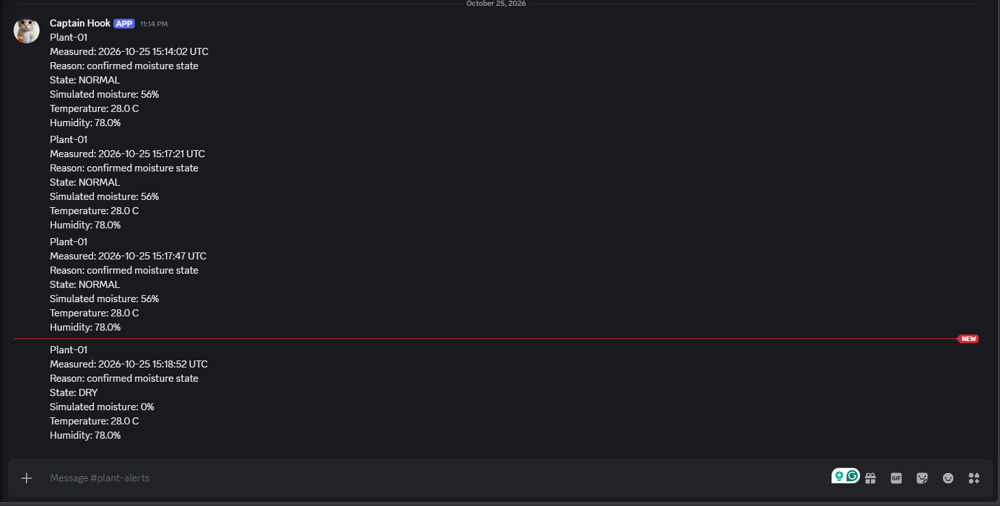

# ESP32-to-Discord delivery test

## Initial failure
Discord HTTPS failed with:
"No matching trusted root certificate found."

Slack delivery and sensor sampling continued.

## Configuration change
Enabled certificate-bundle cross-signed verification.
Kept certificate verification enabled.

## Observed result
- Slack returned HTTP 200.
- Discord returned HTTP 200 with wait=true.
- Sensor sampling continued at five-second intervals.
- Discord displayed Plant-01 with:
  - Measured: 2026-10-25 15:17:47 UTC
  - State: NORMAL
  - Simulated moisture: 56%
  - Temperature: 28 C
  - Relative humidity: 78%

## Limitations
- Screenshot includes earlier messages from separate measurement times;
  their relationship to uploads or restarts was not established.
- Discord retries, rate-limit handling, and failure paths remain untested.
- Certificate-chain contents were not independently captured.