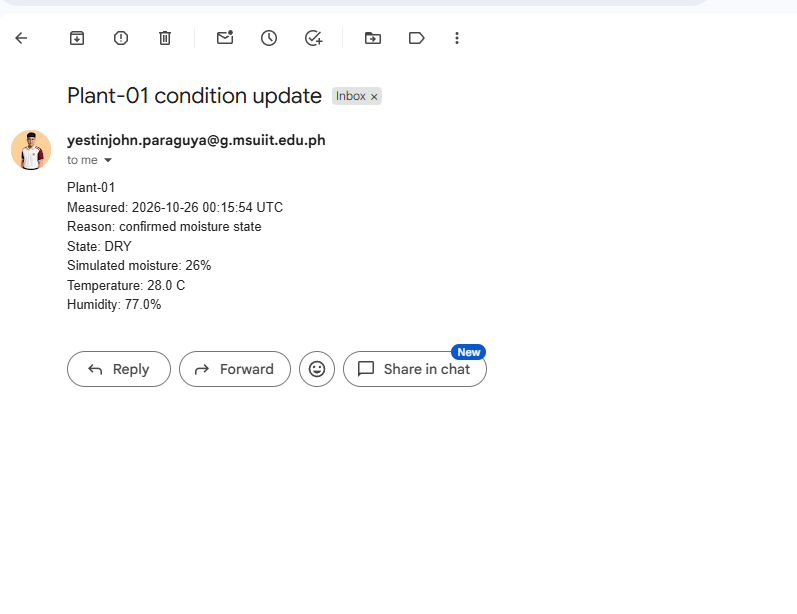

# Gmail SMTP delivery test

## Initial issue
Local validation rejected an app password containing display spaces.
Removing the spaces produced the required 16-character value.

## Observed result
- Connected to smtp.gmail.com on port 465 using verified TLS.
- SMTP authentication succeeded: 235.
- Message accepted after DATA: 250.
- Session closed: 221.
- Email appeared in the inbox with matching measurements:
  - Measured: 2026-10-26 00:15:54 UTC
  - State: DRY
  - Simulated moisture: 26%
  - Temperature: 28 C
  - Relative humidity: 77%
- Sensor sampling continued every five seconds.

## Limitations
SMTP rejection, timeout, retry, and rate-limit handling remain
separately untested. Overall lab validation is not complete.