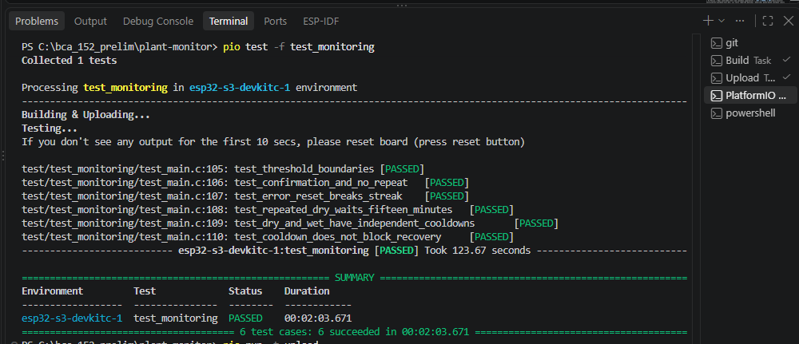
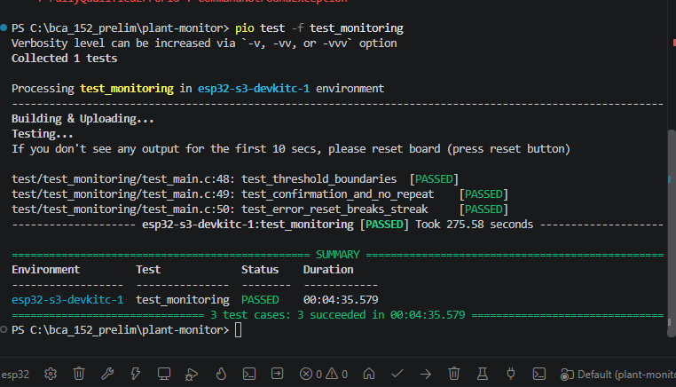

# Monitoring unit tests

Command: pio test -f test_monitoring
Framework: Unity
Target: ESP32-S3

## Expanded six-test run

Command: `pio test -f test_monitoring`  
Framework: Unity  
Environment: `esp32-s3-devkitc-1`  
Result: **6 tests passed, 0 failed**  
Total build/upload/test duration: **123.671 seconds**

| Test | Observed result |
|---|---|
| `test_threshold_boundaries` | Passed |
| `test_confirmation_and_no_repeat` | Passed |
| `test_error_reset_breaks_streak` | Passed |
| `test_repeated_dry_waits_fifteen_minutes` | Passed |
| `test_dry_and_wet_have_independent_cooldowns` | Passed |
| `test_cooldown_does_not_block_recovery` | Passed |

Cooldown tests use synthetic monotonic timestamps, not a fifteen-minute hardware wait. The explicit reset test does not inject a physical ADC error. Raw-to-percent conversion, message formatting, numeric rejection, sequence gaps, and queue overflow remain outside this suite.

### Application restored after testing

After uploading the normal application again, the supplied log showed:
- Samples at approximately 2.502, 7.502, and 12.502 seconds.
- DRY confirmed at 12.502 seconds.
- DHT11 readings of 31 C and 71% RH.
- Clock synchronization before dispatch.
- Slack, Discord, Telegram, and Gmail submission acceptance.
- Continued sensor acquisition during dispatch.

The boot log displayed application version `1b65beb`; this record preserves the reported value rather than inferring an exact source checkout from it. Recipient screenshots for this restoration run were not supplied.

## Original three-test baseline
3 test cases passed:
- Threshold boundaries: 29%, 30%, 70%, 71%.
- Confirmation on the third matching reading, without repeats.
- Explicit streak reset requires three new matching readings.

Total build/upload/test duration: 275.58 seconds.

The reset test calls monitoring_reset_streak() directly;
it does not simulate a physical ADC fault.

At this original baseline, cooldown was not implemented. The six-test run above supersedes that historical status.

