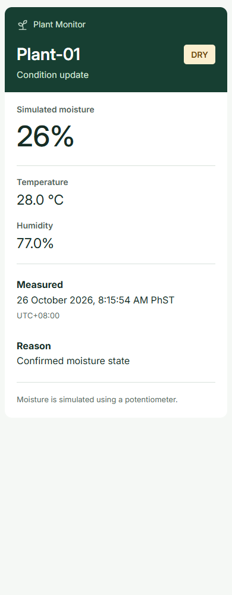
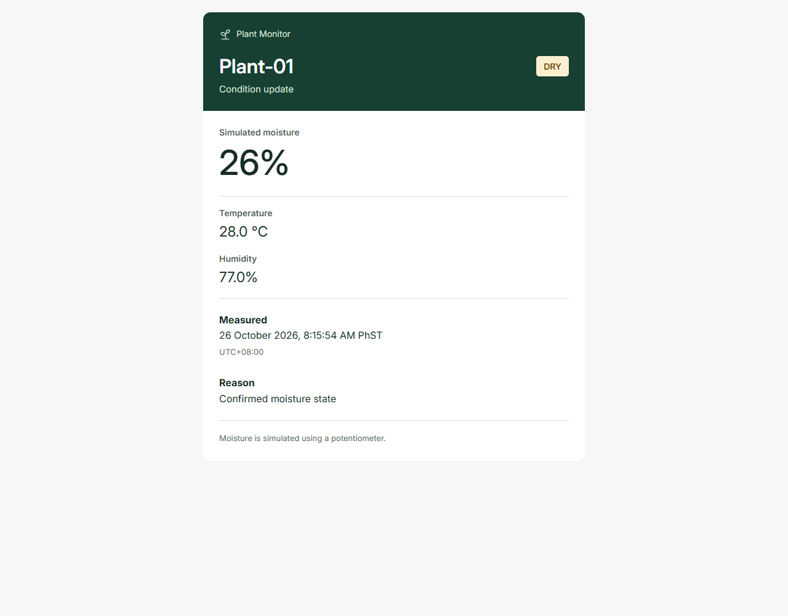

# Responsive notification layout follow-up

[Results index](README.md) · [Code guide](../code-guide.md) · [Earlier formatting record](notification-formatting-test.md)

## Scope and status

Review date: 26 October 2026. The builder reported cramped phone layouts and approved the [four-service phone proposal](../assets/notifications/mobile-design-preview.png). This follow-up changes presentation, not sensing, confirmation, cooldown, dispatch order, TLS, credentials, or time conversion.

The records below are offline checks of actual generated HTML/JSON and the copied Gmail sender. **No ESP32 upload, provider request, or new inbox/chat capture is claimed.** Real phone and desktop recipient rendering remains pending.

## Changes

- Gmail uses a fluid card up to 620 px wide. Moisture, temperature, and humidity occupy separate full-width blocks. At 480 px or narrower, supported media-query CSS reduces padding and heading/number sizes. Inline styles retain the stacked layout if that style block is removed.
- Discord sends six named fields with `inline: false`. The invisible seventh spacer is removed.
- Slack uses full-width section text instead of a `fields` array that requests two columns. Bold labels, grouped readings, captured time, reason, qualification, and complete accessible fallback text remain.
- Telegram already uses the approved wrapping text structure. Its HTML parse mode and grouped bold labels are retained; no fixed-width or space-padded alignment is introduced.
- Inter remains a Gmail font preference with Arial/system fallbacks. Chat apps control their fonts and final spacing.

## Regression evidence

Before the fix, new assertions failed because Slack still supplied `fields` and Discord still supplied seven fields. A 360 px browser check also failed: the temperature label appeared at y=208 px while the moisture value ended at y=328.80 px, proving that the readings were still side by side.

After the fix:

| Check | Result |
|---|---|
| Host formatting suite | 17 named cases passed; Slack/Discord assertions now cover stacked payloads |
| Host timezone independence | Same suite passed under the default environment, UTC0, and PST8PDT; not extra distinct cases |
| SMTP/MIME | Three complete simulated sessions passed: normal, missing DHT, unknown clock |
| Failed-write cleanup | Returned failure and released the simulated connection |
| Firmware build | `pio run` passed in 42.36 s |
| Static RAM | 42,064 / 327,680 bytes |
| Flash | 1,349,941 / 4,194,304 bytes |
| Live phone/web recipients | Pending |

[Captured host output](responsive-notification-output.txt) is retained. Earlier static-analysis and hardware results remain separate historical records.

## Actual HTML browser checks

Headless Chromium rendered HTML produced by the real formatter. The normal, missing-DHT, and unknown-clock HTML was extracted from the simulated SMTP submissions, not recreated from the mockup.

Thirty cases passed:

- Three SMTP scenarios at 320, 360, 390, 430, 768, and 1280 px: 18 cases.
- Those scenarios with the optional style block removed at 320 and 1280 px: 6 cases.
- NORMAL, WET/100%, and combined unavailable-clock/DHT fixtures at 320 and 1280 px: 6 cases.

Each case checked vertical reading order, absence of horizontal overflow, timestamp bounds, essential content, and the loaded inline image. Unknown readings/time stayed explicit; NaN/infinity text was not displayed. The native payload checks required no Slack field grid, six full-width Discord fields without zero-width spacers, and Telegram HTML without fixed-width/preformatted alignment.

The browser resolved the email CID to the same local PNG and loaded the installed Inter font for inspection only. Firmware does not fetch that font or an external image. This is not a Gmail app, Slack client, Discord client, Telegram client, or screen-reader test.

[Viewport audit](responsive-layout-checks.csv) records all thirty cases. These are local renders of sample data:





## Reproduce and finish on the device

Run the existing host checks with an installed GCC-compatible compiler and the managed cJSON dependency:

```powershell
python scripts/test_notification_format.py --output-dir notification-examples
```

Generated `gmail.html`, `gmail-normal-state.html`, `gmail-wet-state.html`, and `gmail-unavailable.html` can be inspected locally at the recorded widths. The three `.eml` files are simulated messages with dummy settings. The inline CID needs the included plant-mark PNG resolved locally for a browser-only view. The temporary browser harness used installed Playwright/Chromium; it is not a firmware dependency.

For final acceptance, upload production firmware, trigger one confirmed state, and compare the same captured event in each service on both the phone and desktop/web client. Check label/value visibility, natural date wrapping, unavailable values, and the simulation note. Preserve actual recipient screenshots separately from the local browser images above.

## References and limits

Slack documents `fields` as compact two-column content; [section text](https://docs.slack.dev/reference/block-kit/blocks/section-block/) avoids requesting that grid. Discord exposes an [inline field flag](https://docs.discord.com/developers/resources/message#embed-object-embed-field-structure). Gmail documents its [CSS/media-query support](https://developers.google.com/gmail/design/css); the inline fallback keeps reading order independent of that support.

Actual client theme/font scaling, accessibility behavior, delivery latency, and device stack margins remain unmeasured. The six ESP32 monitoring tests were not uploaded/rerun for this presentation-only change.
