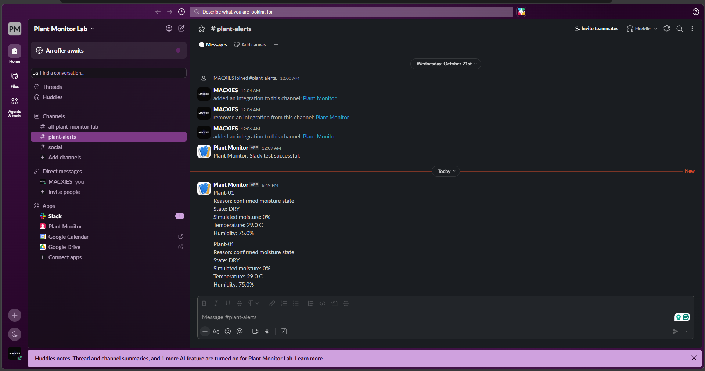
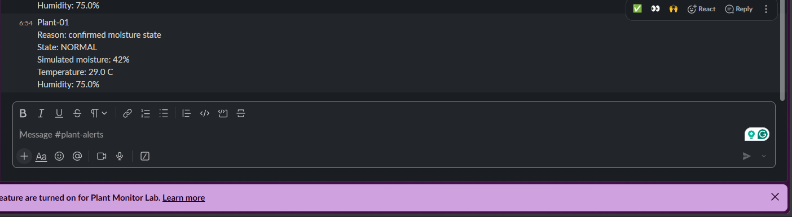

# First ESP32-to-Slack delivery test

## Observed results
- Clock synchronized through SNTP.
- TLS log reported: Certificate validated.
- Slack returned HTTP 200.
- A message appeared in the Slack channel with matching values:
  Plant-01, DRY, simulated moisture 0%, temperature 29 C,
  relative humidity 75%.

## Limitations
- Screenshot contains two identical updates; whether these followed
  separate boots or occurred during one run is not yet established.
- Measurement timestamps are not included in the message yet.
- Bounded delivery retries, rate-limit handling, and cooldown
  remain pending.
- Local webhook credentials are excluded from Git.

## NORMAL transition test

During the same running session:
- NORMAL candidate counts progressed from 1/3 to 3/3.
- State confirmed at 272501 ms.
- TLS certificate validation succeeded.
- Slack returned HTTP 200 at 274171 ms.
- One NORMAL message appeared with simulated moisture 42%,
  temperature 29 C, and humidity 75%.

The supplied excerpt ends after delivery. A full 30-second
no-repeat observation is not established by this excerpt.
The cause of the two earlier DRY messages remains unconfirmed.

