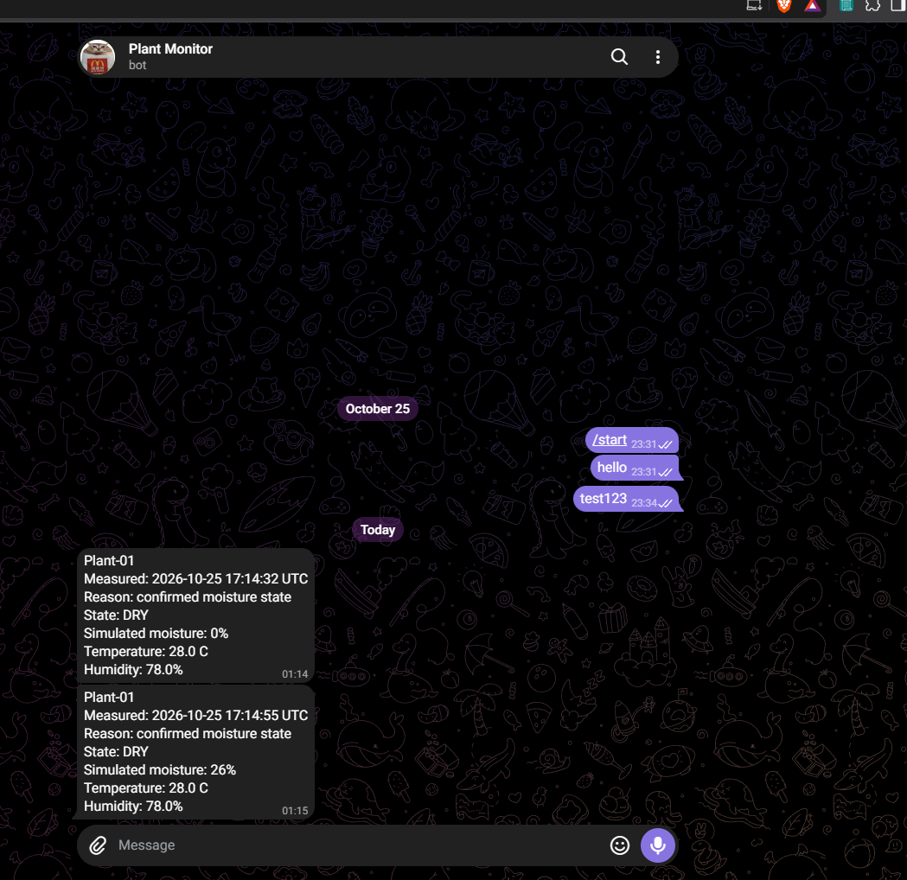

# Telegram delivery test

## Observed result
Plant-01 message received in the bot chat:

- Measured: 2026-10-25 17:14:55 UTC
- State: DRY
- Simulated moisture: 26%
- Temperature: 28 C
- Relative humidity: 78%

Device logs reported HTTP 200, and the JSON ok-field check passed.
Sensor sampling continued every five seconds.

## Limitations
Retries, rate-limit handling, invalid credentials,
and oversized-response handling remain untested.