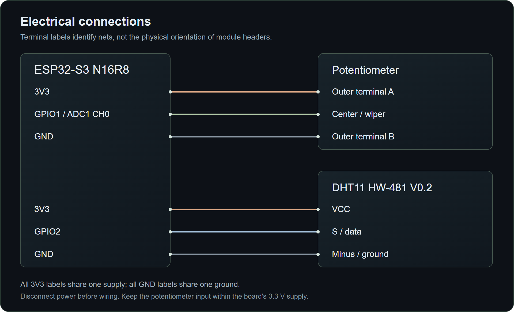
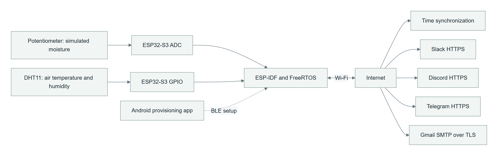
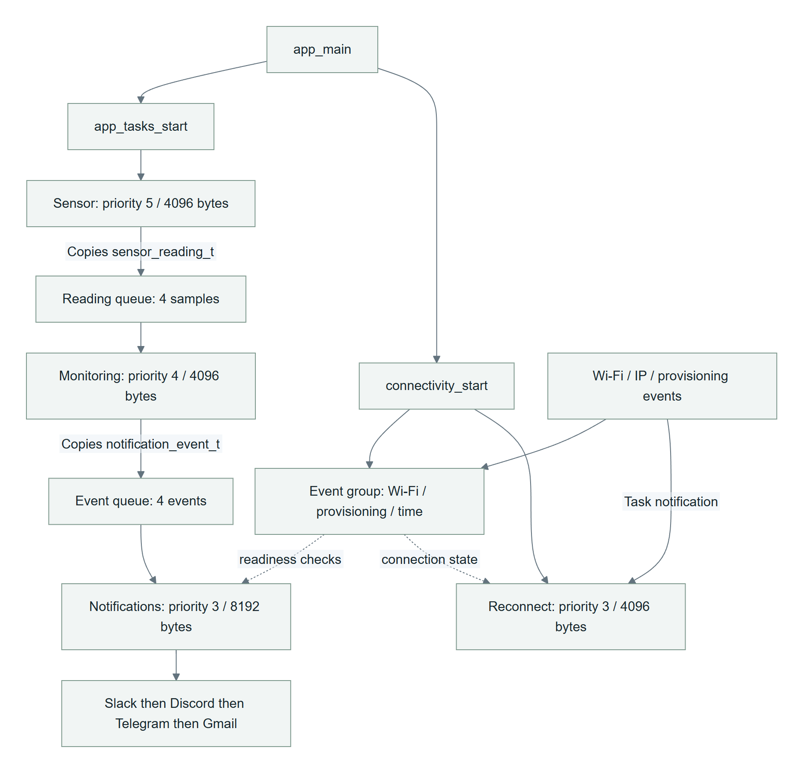
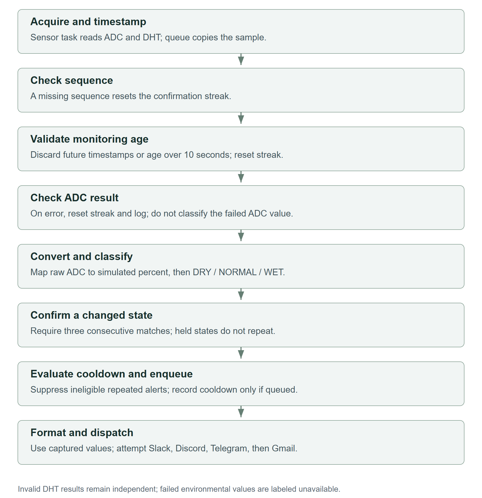
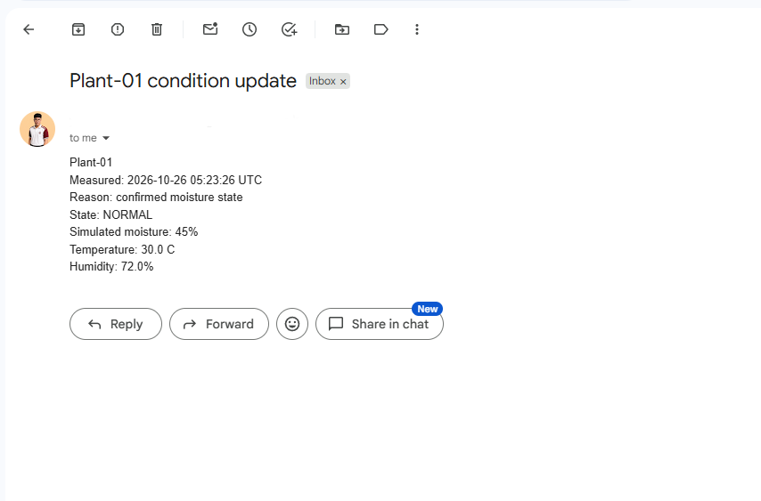
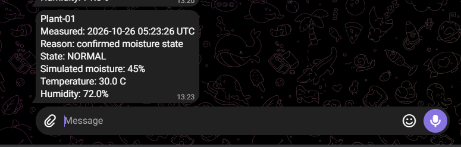
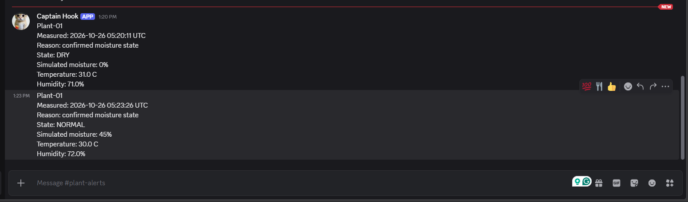
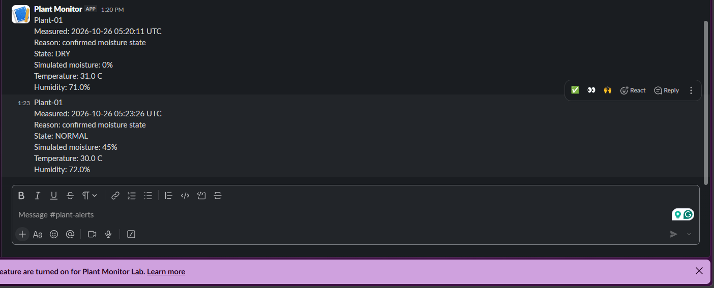

# Smart Plant Monitoring System

## Using ESP32, FreeRTOS, and Internet Communication Services

**Technical report — Project No. 1**

**Authors:** Yestin John Paraguya; Kenneth Restauro; Regine Bermudo  
**Course and section:** BCA152 Microcontrollers — B186  
**Institution:** Mindanao State University – Iligan Institute of Technology  
**College / department:** College of Computer Studies / Department of Computer Applications  
**Instructor:** Asst. Prof. Paul Rodolf P. Castor, M.Sc.  
**Report date:** 26 October 2026  
**Repository:** https://github.com/xavieryyyyyy/esp32_smart-plant-monitoring-system  
**Evidence checkpoint:** `67f1157` (matching four-channel delivery record)

<!-- pagebreak -->

## Abstract

This project implemented an ESP32-S3 monitoring and notification prototype using C, ESP-IDF, and FreeRTOS. A potentiometer provided repeatable simulated moisture input, while a DHT11 measured air temperature and relative humidity. Separate acquisition, monitoring, notification, and reconnection tasks coordinated through queues, event-group flags, and task notifications. Readings were acquired every five seconds; three successive valid samples in the same classification confirmed a state. DRY and WET notifications used independent fifteen-minute cooldowns. The device received Wi-Fi credentials through BLE provisioning, synchronized its clock, and initiated verified TLS requests to Gmail, Telegram, Discord, and Slack.

The final delivery experiment showed one NORMAL event, measured at 2026-10-26 05:23:26 UTC, in all four recipient applications with identical values: 45% simulated moisture, 30.0 C, and 72.0% relative humidity. Sequential dispatch completed in 14.680 seconds from state confirmation to the final Gmail submission-accepted log. Six monitoring unit tests passed. Controlled experiments also demonstrated stale-sample rejection, duplicate-alert suppression, bounded Slack retry behavior, and reconnection after a device-originated Wi-Fi disconnect. The results establish the observed prototype behavior, not soil calibration, measurement accuracy, guaranteed delivery, or full reliability under prolonged faults. Remaining limitations include intermittent DHT11 timeouts, incomplete numeric and formatting tests, absent retry policies for three services, and an unfinished final demonstration.

**Keywords:** ESP32-S3; ESP-IDF; FreeRTOS; BLE provisioning; sensor validation; TLS; event-driven notification.

## Report organization

Sections 1–6 describe the problem, hardware, sensor interpretation, firmware, connectivity, and API design. Sections 7–8 present methods and measured results. Sections 9–11 discuss the findings, requirement coverage, limitations, and conclusions. References and appendices provide the evidence index and reproduction procedure.

The editable Markdown and rendered PDF describe the same implementation. Figures use the actual assembly photograph, source-derived architecture, and recorded recipient outputs. No illustrative mockup is used as experimental evidence.

<!-- toc -->
<!-- pagebreak -->

## 1. Problem and objectives

### 1.1 Problem statement

A monitoring device should turn repeated sensor readings into useful condition updates without sending a message at every sample. It should distinguish a stable change from a brief input fluctuation, continue essential acquisition during communication, and expose failures rather than presenting failed measurements as valid values. The BCA152 project brief requires this behavior through ESP-IDF, active FreeRTOS coordination, secure networking, genuine external delivery, and reproducible documentation [1].

This prototype addresses those requirements on an ESP32-S3 N16R8. Its input is a potentiometer-based moisture simulation, complemented by DHT11 environmental readings. The work focuses on monitoring and notifications. Automatic watering, a custom mobile application, an MQTT broker, a cloud database, and machine learning are outside its implemented scope.

### 1.2 Objectives

1. Acquire and validate sensor inputs on a five-second schedule.
2. Convert ADC readings into a documented simulated index and classify DRY, NORMAL, and WET states.
3. Confirm changes using three consecutive valid readings and suppress repeated identical alerts during cooldown.
4. Separate hardware acquisition, processing, communication, and network recovery through FreeRTOS tasks and signaling.
5. Provision Wi-Fi through BLE, reuse saved credentials, synchronize time, and retain certificate verification.
6. Deliver one captured event through four selected Internet services and compare visible recipient outputs with device logs.
7. Record unit, integration, fault-injection, compiler, and static-analysis results with their limits.

### 1.3 Adaptations and interpretation of requirements

The original brief specifies a capacitive soil sensor, DHT22, Gmail, WhatsApp, Telegram, and X. The available prototype uses a potentiometer, DHT11 HW-481 V0.2, Gmail, Telegram, Discord, and Slack. Instructor permission for these adaptations was reported during development. The report preserves the distinction: potentiometer output is a simulated input index, Discord is not WhatsApp delivery, and Slack is not X posting. The original requirement matrix and the adapted evidence are compared in Section 10.

The potentiometer permits controlled state transitions but does not reproduce soil-sensor characteristics, plant needs, or soil water content. Likewise, successful transport and recipient delivery do not establish agronomic suitability. These boundaries are part of the experimental interpretation, not missing details to be inferred from screenshots.

<!-- pagebreak -->

## 2. Hardware and wiring

### 2.1 Components and electrical connections

**Table 1. Hardware components and electrical roles.**

| Component | Function | Connection or configuration |
|---|---|---|
| ESP32-S3 N16R8 | Processing, Wi-Fi, BLE | 16 MB flash configured; module designation includes 8 MB PSRAM, whose use remains unverified |
| Potentiometer | Simulated moisture input | Outer terminals across 3V3/GND; center wiper to GPIO1 |
| DHT11 HW-481 V0.2 | Air temperature and humidity | S to GPIO2, VCC to 3V3, minus to GND |
| Breadboard and jumpers | Interconnection | Common supply reference and ground |
| USB data cable | Power, programming, console | Serial monitor configured for 115200 baud |
| Android phone | Initial network configuration | Espressif ESP BLE Provisioning application |

GPIO1 is configured as ADC1 channel 0, with 12-bit width and 12 dB attenuation. GPIO2 is used for the DHT11 data line. The firmware enables its internal pull-up. The module's external pull-up was not independently measured. The physical pin labels on the actual board must take precedence over diagrams for other ESP32 variants [2,3].


<!-- pagebreak -->

### 2.2 Wiring diagram and configuration history



Power should be disconnected before modifying the circuit. The potentiometer center remains the ADC connection if outer terminals are exchanged to reverse turn direction. Left-decreases/right-increases was discussed, but a separate direction acceptance test was not recorded.

The base PlatformIO profile is `esp32-s3-devkitc-1`. Its printed N8 description does not identify the physical module. ESP-IDF flash configuration was changed from an initial 2 MB to 16 MB. A separate custom partition table enlarged the factory application slot from 1 MB to 4 MB after networking and BLE increased binary size. Physical flash capacity and app-partition capacity are different settings. The current partition table has no OTA app slots.

### 2.3 Build environment

**Table 2. Recorded development environment.**

| Item | Recorded value |
|---|---|
| Language and framework | C; `framework = espidf` |
| PlatformIO Core | 6.2.0 |
| Static analyzer | Cppcheck 2.11; reported scope `src` |
| Espressif32 platform | 7.1.2 |
| ESP-IDF | 6.1.0 |
| Xtensa toolchain package | `15.2.0+20251204` |
| DHT component | `esp-idf-lib/dht` 1.2.0 |
| Network provisioning component | `espressif/network_provisioning` 1.3.2 |
| JSON component | `espressif/cjson` 1.7.19~2 |

Component hashes and resolved versions are tracked in `dependencies.lock`. The platform entry itself remains unpinned, so a fresh installation may resolve a different tool set. Reproducibility is aided by recorded versions but has not been established through a separate clean-clone build of the final documentation checkpoint. No Arduino framework or Arduino-style application structure is used.

<!-- pagebreak -->

## 3. Sensor interpretation and validation

### 3.1 Simulated moisture index

The conversion is:

```text
simulated_percent = (raw * 100) / 4095
```

Integer division truncates the result. Raw 0 maps to 0%, and raw 4095 maps to 100%. The mapping does not claim calibrated voltage, linear knob angle, or physical soil moisture. ADC saturation near an endpoint is possible.

**Table 3. Simulated moisture classification thresholds.**

| Simulated index | Classification | Bench interpretation |
|---|---|---|
| Below 30% | DRY | Low test input |
| 30–70%, inclusive | NORMAL | Middle test input and recovery state |
| Above 70% | WET | High test input |

Stationary raw ranges of 3345–3355 and 1814–1819 were observed at two knob positions. Those observations suggest small variation at those positions during the recorded runs; they are not a noise characterization or accuracy estimate. No software smoothing was added. The thresholds were chosen for repeatable demonstration rather than a specific plant.

For a real capacitive soil sensor, calibration would require dry and sufficiently wet reference samples, documentation of supply and sensor placement, response-direction determination, endpoint-based conversion, and repeat tests. None of those soil calibration measurements was performed with this potentiometer prototype.

### 3.2 Validation and independent sensor health

ADC driver failures retain their error code. Successful values outside 0–4095 are rejected. Successful DHT readings must be finite, with humidity within 0–100%. Caller outputs update only after successful validation. A finite but physically implausible temperature may still pass because a DHT-specific temperature range is not implemented.

The ADC and DHT results are independent fields in each reading. A failed DHT transaction does not prevent a valid moisture classification; temperature/humidity are reported as unavailable. DRY or NORMAL refers to the simulated moisture classification, not a declaration that every sensor is healthy. An in-range ADC voltage also cannot prove that a potentiometer is connected correctly.

### 3.3 Confirmation and freshness

Three successive valid samples in the same classification confirm a state. Numeric values may differ within the same classification. A new candidate restarts the streak. ADC errors, discarded stale samples, or detected sequence gaps reset it. Holding an already confirmed state does not repeatedly confirm it. This is consecutive-reading persistence, not separate hysteresis entry and exit bands.

Each sample carries an acquisition-start timestamp from `esp_timer_get_time()`. Monitoring rejects negative age or age greater than ten seconds. Exactly ten seconds is accepted by the comparison but was not separately tested. This monotonic check works before Internet clock synchronization. It applies when monitoring consumes a sample, not before each later external delivery.

<!-- pagebreak -->

## 4. ESP-IDF and FreeRTOS architecture

### 4.1 System organization

The firmware separates peripheral acquisition, monitoring logic, connectivity, and service senders. `app_main()` starts application tasks and connectivity. Public component headers define interfaces; CMake declares source files and dependencies. ESP-IDF provides FreeRTOS, drivers, networking, TLS, logging, and NVS [2,4].



### 4.2 Task scheduling and signaling

**Table 4. Application task priorities, allocated stacks, and responsibilities.**

| Task | Priority | Allocated stack | Responsibility |
|---|---:|---:|---|
| Sensor | 5 | 4096 bytes | Initialize/read ADC and DHT; timestamp and enqueue samples |
| Monitoring | 4 | 4096 bytes | Check sequence/age; classify, confirm, and evaluate cooldown |
| Notification | 3 | 8192 bytes | Format captured event and call four service senders |
| Wi-Fi reconnect | 3 | 4096 bytes | Wait for notifications; reconnect with backoff |

The sensor task uses `vTaskDelayUntil()` with a five-second period. Monitoring and notification tasks block on their input queues. Wi-Fi reconnection uses task notifications and readiness flags. Queues have four elements each and use nonblocking sends. An allocation/task-creation failure is checked, while a full queue logs a dropped item.

Priorities give sensing precedence over lower-priority work but are not a measured hard real-time guarantee. Tasks are not explicitly pinned to cores. Stack values are allocations, not measured remaining margins.

<!-- pagebreak -->

### 4.3 Ownership and inter-task communication



The sensor task owns hardware acquisition. `sensor_reading_t` contains a sequence number, monotonic time, optional UTC time, raw ADC value, DHT values, and separate result codes. Queue sends copy the structure by value, so a subsequent acquisition cannot overwrite a queued sample.

The monitoring task owns its `monitoring_t` object. A notification event copies the reading, interpreted percentage, and state string into the second queue. Only the notification task calls senders. Slack's static rate-limit state therefore assumes a single caller. Wi-Fi readiness, provisioning state, and time readiness are represented by event-group bits; Wi-Fi/IP/provisioning callbacks signal the reconnect task.

When a reading queue overflows, the next received sequence gap can break confirmation. A notification-queue drop does not roll back the confirmed state and is not automatically replayed. There is no persistent event store or delivery acknowledgment per recipient.

<!-- pagebreak -->

### 4.4 Processing path



<!-- pagebreak -->

### 4.5 Reading and maintaining the source

The entry point, task coordinator, component interfaces, and build declarations have different responsibilities. `src/main.c` starts the tasks and connectivity. `src/app_tasks.c` moves copied samples through monitoring into a notification snapshot. The sensor component owns hardware access, monitoring owns decision logic, connectivity owns network/time state, and the four notification implementations own protocol requests. Appendix C maps the individual files and their connections. `docs/code-guide.md` provides the longer walkthrough and serial-log explanation.

Explanatory comments describe these boundaries, acquisition versus dispatch time, queue ownership, and failure outcomes. They preserve the existing logic, including the failed-DHT timestamp omission and cooldown accounting at enqueue. Comments are not evidence that an untested fault path passed.

## 5. Network provisioning and transport security

### 5.1 BLE onboarding and saved credentials

The Android ESP BLE Provisioning app sends credentials to the ESP32 through NimBLE using Espressif's `network_provisioning` component. The unprovisioned device advertises a name beginning `PROV_PLANT_`. A generated proof-of-possession code is printed locally for security-version-1 onboarding. It must be treated as private setup material [5].

After successful setup the configured BLE cleanup releases Bluetooth memory, and NVS retains Wi-Fi credentials. On later boots, station mode starts with those saved credentials. BLE is not the message transport. An earlier teardown run logged advertising error `rc = 30`; provisioning and later saved-credential connection worked, but the teardown issue was not fully diagnosed.

### 5.2 Reconnection and time

Wi-Fi disconnection clears the ready bit and notifies a dedicated reconnect task. Retry delays grow from one second to two, four, eight, sixteen, then at most thirty seconds. Provisioning state prevents the reconnect task from taking over association while the manager is configuring it. A temporary disconnect does not require a board restart.

SNTP uses `pool.ntp.org`. Its synchronization callback sets time readiness, and healthy-DHT messages retain the acquisition-time UTC value. All senders require both network and synchronized time. Readiness does not automatically replay an initial event that failed before connectivity was available. A user-facing command to erase/reprovision saved Wi-Fi credentials is not implemented.

### 5.3 TLS and credential boundaries

All integrations use ESP-IDF's root certificate bundle. Full-bundle and cross-signed verification support are enabled. Certificate validity-date checking is enabled through `CONFIG_MBEDTLS_HAVE_TIME_DATE=y`; verification is not disabled to make a test pass. Successful requests after enabling this setting demonstrate compatible operation, not rejection of expired or not-yet-valid certificates.

Private webhook URLs, bot token/chat ID, and SMTP credentials are defined in ignored `components/notifications/config.local.h`. A tracked example contains placeholders. Git ignore rules reduce accidental staging but cannot undo earlier disclosure, and secrets remain present in compiled firmware. Flash encryption, secure boot, and encrypted credential storage were not demonstrated. The printed BLE setup code and private recipient identifiers also require care in public captures.

HTTPS clients have ten-second configured timeouts and disable automatic redirects. SMTP uses verified immediate TLS on port 465 with reply-code checks and bounded reply processing. These mechanisms do not establish a hard total deadline for a multi-command session or for all four sequential senders.

<!-- pagebreak -->

## 6. Notification design and service integration

### 6.1 Initial, alert, and recovery behavior

The confirmed state starts as UNKNOWN. Three matching samples establish the initial state; later confirmed transitions create eligible events. At a five-second sampling period, the first-to-third sample span is approximately ten seconds, plus the initial acquisition delay. Initial reports, alerts, and recovery events currently share the reason string `confirmed moisture state`.

DRY and WET each have a default fifteen-minute cooldown stored in `monitoring_t`. NORMAL recovery remains eligible. Cooldown begins after successful queue insertion rather than after completed delivery, and it resets on reboot. Holding a state produces no periodic reminders. A suppressed transition is not automatically sent once cooldown expires. Failed events are not durably replayed.

### 6.2 Payload and dispatch

A healthy-DHT message contains plant ID, measurement UTC, reason, state, simulated moisture, temperature in Celsius, and relative humidity. Values are captured with the event rather than replaced by current readings during delivery. The failed-DHT branch labels environmental values unavailable but currently omits the measurement timestamp. This is a payload-completeness gap relative to the brief.

The formatter uses a 384-byte buffer and rejects formatting errors/truncation. Senders run sequentially: Slack, Discord, Telegram, then Gmail. Failure of one is logged and does not skip the later senders. Events may wait in the queue and become older than the latest local readings; there is no dispatch-age guard.

**Table 5. Selected services, transport/authentication, and acceptance checks.**

| Service | Transport/authentication | Acceptance criterion |
|---|---|---|
| Slack | HTTPS JSON `text`; private incoming-webhook URL | HTTP 200; response body not independently checked for `ok` |
| Discord | HTTPS webhook; `content`, disabled mention parsing, `wait=true` | HTTP 200 |
| Telegram | HTTPS `sendMessage`; bot token and chat ID | HTTP 200 plus JSON `ok: true`; response overflow detected |
| Gmail | SMTP/TLS at `smtp.gmail.com:465`; app password via AUTH LOGIN | Expected codes, including authentication 235 and post-DATA 250 |

The selected APIs are direct device integrations, not a hosted relay [6–9]. Provider account requirements and future pricing remain outside the firmware's control. No claim of unlimited free access is made.

### 6.3 Retry and rate policy

Only Slack has an automatic retry loop. It permits up to three attempts, with approximately two- then four-second waits for selected temporary errors. For 429 responses it uses numeric `Retry-After`. A missing/invalid delay pauses Slack until restart. A required wait over the thirty-second waiting budget abandons that event while retaining the next-request deadline. Ambiguous failures can result in duplicate requests.

Discord, Telegram, and Gmail return failures without automatic retry. Account expiration and the full response/error matrix are not comprehensively tested. API acceptance is logged, but visible recipient output remains necessary evidence of delivery.

<!-- pagebreak -->

## 7. Test methodology

### 7.1 Evidence sources and experimental scope

Evidence consists of the saved source/configuration, device serial excerpts, unit-test output, analysis records, the actual assembly photograph, and recipient screenshots. Earlier integration records describe different firmware milestones and measurement times. The final matching-event experiment is treated separately so it cannot be inferred from unrelated screenshots.

The test records contain single observed runs or controlled experiments; they do not provide a statistical sample sufficient for reliability estimates, latency distributions, or accuracy claims. Repeated code paths and synthetic time checks supplement hardware observations but do not replace external delivery evidence. Exact source-to-binary provenance was not established for every historic capture.

### 7.2 Test procedures

**Table 6. Test procedures and their acceptance observations.**

| Experiment | Procedure | Acceptance observation |
|---|---|---|
| Normal sensing and confirmation | Move potentiometer through ranges; hold for three samples | Classification confirmed after third valid match; acquisition continues |
| Unit tests | `pio test -f test_monitoring` using Unity on ESP32-S3 | Six named cases pass without failures |
| Cooldown | DRY, then NORMAL, then DRY in one boot inside fifteen minutes | First DRY/NORMAL dispatched; repeated DRY suppressed |
| DHT disconnection | Disconnect signal in a controlled bench test; later restore | Explicit errors without false DHT values; ADC monitoring continues |
| Stale sample | Temporarily subtract eleven seconds from third sample timestamp | Rejection resets streak; three fresh samples needed |
| Wi-Fi recovery | After IP acquisition, request one ESP32 disconnect | Disconnect detected; retry and new IP acquisition |
| Slack fault injection | Inject 503 or 429/delay inside sender | Bounded attempts and requested waits; no uncontrolled loop |
| Four-channel event | Confirm NORMAL and inspect all recipients | Identical timestamp and values visible in four applications |
| Build/analysis | Clean build, warning search, `pio check --skip-packages` | Recorded build result and analysis findings, including limitations |

Temporary test triggers were removed after their tests. Cleanup runs verified normal operation after retry/stale/disconnect injection. Unit testing replaces the running application with test firmware; the production application was subsequently uploaded and normal sensing/service acceptance was observed.

### 7.3 Timing interpretation

Serial timestamps are device uptime in milliseconds, whereas message timestamps are captured UTC measurement time. Their roles are distinct. Sequential completion times are calculated relative to confirmation in one run. They include earlier senders and local processing and must not be interpreted as isolated provider latency or arrival time at the recipient.

The cooldown tests use synthetic monotonic timestamps. The duration reported by PlatformIO includes build and upload, not only assertion execution. The old-timestamp experiment injects age; it does not create a real queue backlog. These methodological limits constrain the conclusions in Section 9.

## 8. Results

### 8.1 Matching four-channel delivery

One NORMAL event appeared in Gmail, Telegram, Discord, and Slack with the fields in Table 7. The redacted Gmail image retains the measurement contents. Earlier DRY entries in the Discord/Slack captures are distinct events and are not counted as the matching observation. Appendix A shows all four recipient captures.


**Table 7. Shared event identity verified in four recipient screenshots.**

| Field | Observed value |
|---|---|
| Device | Plant-01 |
| Measurement time | 2026-10-26 05:23:26 UTC |
| Reason | confirmed moisture state |
| State | NORMAL |
| Simulated moisture | 45% |
| Temperature | 30.0 C |
| Relative humidity | 72.0% |

Candidate samples were 33%, 42%, and 45%, all NORMAL. Confirmation occurred at uptime 207502 ms and used the third sample. The record therefore demonstrates consecutive classification persistence, not a requirement for identical numeric values.


**Table 8. Sequential dispatch observations for the matching event.**

| Observation | Uptime, ms | Elapsed from confirmation |
|---|---:|---:|
| NORMAL confirmed | 207502 | 0.000 s |
| Slack request accepted | 209392 | 1.890 s |
| Discord request accepted | 212672 | 5.170 s |
| Telegram request accepted | 215342 | 7.840 s |
| Gmail server accepted after DATA | 221872 | 14.370 s |
| Gmail submission accepted after closing session | 222182 | 14.680 s |

Slack, Discord, and Telegram returned HTTP 200. Gmail showed authentication 235, DATA continuation 354, post-DATA 250, and QUIT 221. Recipient visibility supplies proof beyond the serial acceptance logs. Sensor samples at 212502, 217502, 222502, and 227502 ms showed the five-second interval continuing during dispatch. These observations do not establish worst-case scheduling or network guarantees.

### 8.2 Unit tests

All six current Unity cases passed. The build/upload/test run took 123.671 seconds; this is not pure test-execution time. The screenshot is Figure 10 in Appendix A.

**Table 9. Current monitoring unit-test cases and observed results.**

| Test | Result | Property exercised |
|---|---|---|
| `test_threshold_boundaries` | Passed | 29% DRY; 30%/70% NORMAL; 71% WET |
| `test_confirmation_and_no_repeat` | Passed | Third-match confirmation, no repeated confirmation while held |
| `test_error_reset_breaks_streak` | Passed | Explicit reset requires three new matching readings |
| `test_repeated_dry_waits_fifteen_minutes` | Passed | Eligibility before/at 900000000 microseconds |
| `test_dry_and_wet_have_independent_cooldowns` | Passed | Separate condition timestamps |
| `test_cooldown_does_not_block_recovery` | Passed | NORMAL eligibility during cooldown |

The earlier three-test baseline is retained in the repository as historical evidence. Raw conversion, message formatting, numeric rejection, physical ADC errors, sequence gaps, and queue pressure are not covered by the six-case suite.

<!-- pagebreak -->

### 8.3 Fault behavior and cleanup


**Table 10. Fault and policy experiments, results, and evidence boundaries.**

| Experiment | Recorded result | Boundary of the evidence |
|---|---|---|
| Hardware cooldown | DRY confirmed at 12.503 s, NORMAL at 27.503 s, repeated DRY suppressed at 42.503 s | Fifteen-minute expiry checked synthetically, not by a full hardware wait |
| Stale injection | Third sample rejected at 12.503 s; fresh counts at 17.513/22.513/27.513 s; DRY then confirmed | Injected timestamp, not actual queue backlog; exact threshold/future-time cases untested |
| Stale cleanup | DRY confirmation returned near 12.513 s without forced warning; services accepted event | Normal restored behavior in supplied run |
| DHT disconnection | Four DHT timeouts while potentiometer monitoring continued; later good reads returned | Does not establish live hot-plug recovery or measurement accuracy |
| Intermittent DHT fault | Timeouts at 122.513 and 352.513 s recovered next sample | Underlying communication cause unresolved |
| Wi-Fi disconnect | Event at 20424 ms; attempt at 21424 ms; IP at 25254 ms | About 4.83 s recovery for device-originated disconnect; router outage untested |
| Slack injected 503 | Three attempts; waits about 2.01 and 4.01 s | Injection bypassed actual server/header processing |
| Slack injected 429 | Injected 3 s delay; attempts at 12469/15499/18509 ms | Header parsing and broader error cases not tested |
| TLS date setting | Four service requests succeeded with date checking enabled | Expired/not-yet-valid certificate rejection untested |

### 8.4 Compiler and static analysis

The recorded clean build succeeded. A search for `warning:` and `warning!` in its saved output returned no matches. This is a compiler-diagnostics review under configured flags, not proof of defect-free firmware.

Cppcheck passed with zero high, zero medium, and two low findings after a shadowed `now_us` declaration was removed. The remaining low findings were `unusedFunction` reports for `app_main`, which ESP-IDF invokes, and `app_tasks_start`, which is called from `src/main.c`. They were retained as analysis limitations rather than used to remove necessary functions.

The documentation-review run verified Cppcheck 2.11 and reproduced the result: zero high, zero medium, and two low findings. The tool version and command output are retained in `docs/results/static-analysis-output.txt`. PlatformIO identifies scope `src`; custom-component coverage remains unestablished. Recording the version closes the earlier tool-identification gap, but does not extend the analyzed scope.

<!-- pagebreak -->

## 9. Discussion

### 9.1 What the observations support

The matching-event experiment establishes visible receipt of one captured event through the four selected services. Matching plant ID, UTC time, state, moisture index, temperature, humidity, and reason provide an event-level comparison. The result is stronger than four unrelated screenshots or a serial log that only says a request was accepted.

Sensor readings continued during the fourteen-second dispatch sequence in that run. This supports the purpose of separating acquisition and communication tasks. It does not prove absence of jitter, worst-case deadlines, or indefinite operation under repeated failures. The measured completion intervals also do not rank the services by intrinsic speed because dispatch is sequential.

The cooldown tests support suppression of a rapid repeated DRY transition while allowing NORMAL recovery. Independent cooldown timestamps avoid making a DRY alert consume WET eligibility. However, recording cooldown on enqueue creates a delivery trade-off: an event may consume eligibility even when no recipient ultimately receives it. Persistent per-channel delivery state would be needed for stronger guarantees.

### 9.2 Validation versus physical confidence

The sensor wrapper distinguishes driver failure from valid output and prevents use of failed DHT values. The freshness experiment demonstrates that an old sample can break a confirmation streak. Those checks improve interpretation, but numeric branch rejection is not experimentally established by normal input runs. Physical sensor disconnection can also produce an in-range ADC value, and finite temperature is not necessarily plausible temperature.

The potentiometer supports controlled low/middle/high transitions. It cannot establish soil calibration, sensor sensitivity to soil conditions, plant-specific thresholds, or agronomic usefulness. DHT11 measurements likewise lack a reference-instrument comparison. These omissions prevent a claim that the prototype measures actual plant water need accurately.

### 9.3 Reliability and security interpretation

A single controlled disconnect demonstrates one reconnection path, not general outage robustness. Similarly, Slack injection verifies the bounded logic exercised, not live parsing of every provider error. Most other service failure cases remain untested. The absence of a queue overflow in supplied logs does not establish adequate capacity under sustained load.

Certificate bundles and date checking remain enabled, and real requests succeeded. This supports configuration and compatibility; a negative certificate test would be required to demonstrate rejection directly. Private source headers and sanitized configuration reduce repository exposure, but secrets remain in firmware and at-rest protections were not evaluated.

The DHT startup adjustment reduced the observed initial-read problem, yet later timeouts show the broader issue remains. A brief unintended low pulse during direction switching is a working hypothesis, not a measurement-backed root cause. The report therefore separates the observed improvement from a confirmed explanation.

### 9.4 Provenance and reproducibility limits

The documentation checkpoint is `67f1157`, which records the matching-event experiment. The restored application boot log displayed `1b65beb`; the matching-event excerpt does not independently identify its exact firmware commit. The checkpoint identifies the documentation/evidence state, not a proven source-to-binary identity for every run. No author-specific contribution or test-execution attribution is inferred from the screenshots.


## 10. Requirement coverage and limitations

### 10.1 Acceptance matrix


**Table 11. Laboratory acceptance cases mapped to current evidence.**

| Case | Evidence | Assessment |
|---|---|---|
| T1 Startup and sensing | Periodic ADC/DHT readings, units, synchronized measurement times | Observed with intermittent DHT failures; failed-DHT messages omit time |
| T2 Calibration and dry/wet states | Potentiometer mapping and three-state demonstration | Adapted; real soil calibration absent |
| T3 Invalid sensor reading | DHT errors/disconnection; wrappers; injected stale sample | Partial; numeric branch and physical ADC fault coverage missing |
| T4 Notification policy | Real confirmed transitions, cooldown experiment, logic tests | Observed within stated queue-based/reboot limits |
| T5 Connectivity loss | Controlled device disconnect and IP reacquisition | Partial; prolonged/router outage and exact sensing continuity unproven |
| T6 Service error/rate limit | Injected Slack 503/429 and attempt bounds | Partial; header/parser and other-channel handling incomplete |
| T7 Four-channel delivery | Four matching recipient captures and serial acceptance | Passed for Gmail, Telegram, Discord, Slack; documented channel adaptation |
| T8 Restart and recovery | Saved credentials reused; startup observations | Observed; systematic repeated-cycle/endurance test pending |

The original brief grades Gmail, WhatsApp, Telegram, and X independently. This report does not rename a Discord message as WhatsApp or a Slack message as an X post. The reported instructor permission should accompany the submission explanation for the adapted channel set.

### 10.2 Remaining implementation and verification work

- Obtain actual dry/wet soil reference measurements before replacing simulated moisture claims with soil calibration.
- Investigate intermittent DHT timing and validate temperature plausibility/measurement accuracy.
- Preserve measurement time in the failed-DHT message branch and distinguish initial, alert, and recovery reasons.
- Add tests for raw conversion, formatting/truncation, invalid-number rejection, sequence gaps, future/exact-boundary timestamps, and queue behavior.
- Measure task stack margins and endurance under concurrent communication failures.
- Complete retry/rate-limit/error policies for Discord, Telegram, and Gmail; exercise real Slack header parsing and ambiguous transport failures.
- Add a controlled reprovisioning mechanism and test prolonged connectivity loss.
- Evaluate dispatch-age handling, durable events, and per-channel delivery state if eventual-delivery guarantees are required.
- Establish custom-component static-analysis coverage and repeat a clean-clone build; Cppcheck 2.11 is now recorded.
- Complete the narrated video or instructor-directed live demonstration.

## 11. Conclusion

The prototype implemented modular ESP-IDF firmware that acquires inputs, confirms simulated moisture states, coordinates concurrent tasks, provisions Wi-Fi through BLE, and sends notifications using verified TLS connections. The strongest delivery result is one event visibly received through all four selected channels with the same measurement timestamp and values. Six monitoring tests passed, and controlled experiments established the specific cooldown, stale-input, retry, and reconnection behaviors described in the results.

These results demonstrate an embedded monitoring and notification workflow. They do not establish actual soil moisture calibration, sensor accuracy, guaranteed eventual delivery, complete service-error handling, or prolonged reliability. The potentiometer/DHT11 and Discord/Slack substitutions remain explicit. The system is suitable for demonstrating the recorded engineering behavior; full acceptance depends on the instructor's adaptation agreement and completion of the remaining verification and demonstration work.

## References

[1] Castor, P. R. P. (2026). BCA152 Project No. 1: Smart Plant Monitoring System Using ESP32, FreeRTOS, and Internet Communication Services. Department of Computer Applications, College of Computer Studies, MSU–IIT. Seven-page laboratory brief supplied for this project.

[2] Espressif Systems. ESP-IDF Programming Guide, ESP32-S3. https://docs.espressif.com/projects/esp-idf/en/stable/esp32s3/

[3] Espressif Systems. ESP32-S3-DevKitC-1 User Guide. https://docs.espressif.com/projects/esp-dev-kits/en/latest/esp32s3/esp32-s3-devkitc-1/user_guide.html

[4] PlatformIO. ESP-IDF framework documentation. https://docs.platformio.org/en/latest/frameworks/espidf.html

[5] Espressif Systems. Network Provisioning component 1.3.2. https://components.espressif.com/components/espressif/network_provisioning/versions/1.3.2

[6] Slack. Sending messages using incoming webhooks. https://docs.slack.dev/messaging/sending-messages-using-incoming-webhooks/

[7] Discord. Webhook resource. https://docs.discord.com/developers/resources/webhook

[8] Telegram. Bot API. https://core.telegram.org/bots/api

[9] Google. Sign in with app passwords. https://support.google.com/accounts/answer/185833

[10] ESP-IDF-Lib. DHT component 1.2.0. https://components.espressif.com/components/esp-idf-lib/dht/versions/1.2.0

[11] Paraguya, Y. J., Restauro, K., and Bermudo, R. Project repository and test records, documentation checkpoint 67f1157. https://github.com/xavieryyyyyy/esp32_smart-plant-monitoring-system

<!-- pagebreak -->

## Appendix A. Recipient and unit-test evidence

The matching event is the NORMAL message measured at 2026-10-26 05:23:26 UTC, with 45% simulated moisture, 30.0 C, and 72.0% RH. The Gmail sender address is covered. Earlier DRY entries visible in Discord and Slack are not part of the matching-event comparison.





<!-- pagebreak -->





<!-- pagebreak -->


### Evidence index

**Table 12. Repository evidence index.**

| Repository record | Subject |
|---|---|
| `docs/results/four-channel-delivery-test.md` | Shared event, serial excerpts, recipient comparison |
| `docs/results/monitoring-unit-tests.md` | Six-case run, screenshot, restored application, earlier baseline |
| `docs/results/notification-cooldown-test.md` | Hardware DRY/NORMAL/DRY suppression |
| `docs/results/stale-sample-test.md` | Injected old timestamp and cleanup |
| `docs/results/dht11-disconnection-test.md` | Missing DHT communication and later good reads |
| `docs/results/sensor-validation-test.md` | Validation regression and intermittent timeouts |
| `docs/results/wifi-reconnection-test.md` | Device-initiated disconnect/recovery |
| `docs/results/slack-retry-test.md` | Injected 503/429 policy checks and cleanup |
| `docs/results/tls-date-validation-test.md` | Successful operation with date checking enabled |
| `docs/results/compiler-build-check.md` | Clean build and warning search |
| `docs/results/static-analysis.md` | Cppcheck results, scope, unresolved findings |
| `docs/progress.md` | Historical milestones and investigations |

<!-- pagebreak -->

## Appendix B. Reproduction procedure

### B.1 Build and private configuration

Open the repository folder containing `platformio.ini`. Copy the safe template once when the local header does not exist:

```powershell
Copy-Item components/notifications/config.example.h components/notifications/config.local.h
git check-ignore components/notifications/config.local.h
pio run
pio run -t upload
pio device monitor
```

Populate the private header with the Slack and Discord webhook URLs, Telegram token/chat ID, and Gmail sender/app-password/recipient. Do not publish those values. Gmail's tested app password has sixteen characters without display spaces. All network requests are initiated by the ESP32. The README documents each service's account setup and official source.

Use the tracked ESP-IDF configuration, 16 MB flash override, and 4 MB factory partition. Component manifests and `dependencies.lock` record the managed dependencies. If adding source files changes the build graph, verify CMake `SRCS` and dependencies; the component-refresh script handles the configuration-change issue encountered during development.

### B.2 Demonstration sequence

1. Connect the hardware according to the pin table and electrical diagram.
2. Upload production firmware. If unprovisioned, configure Wi-Fi from the Android app using the private name/setup code.
3. Wait for IP acquisition and time synchronization.
4. Hold a low input until DRY confirms, then a middle input until NORMAL confirms, then a high input until WET confirms.
5. Compare the captured measurement fields and time in all four recipient applications.
6. Return through NORMAL to DRY within its cooldown, without rebooting, and show local confirmation with notification suppression.
7. Keep serial sampling visible during dispatch. Explain that queued events retain acquisition-time values.
8. Show the actual circuit, architecture, selected service credentials procedure without exposing secrets, and the stated limitations.

### B.3 Tests and restoration

```powershell
pio test -f test_monitoring
pio run -t upload
pio device monitor
pio check --skip-packages
```

Unit testing uploads a different application; production upload is necessary afterward. The optional clean compiler review is:

```powershell
pio run -t clean
pio run 2>&1 | Tee-Object -FilePath build-check.log
Select-String -Path build-check.log -Pattern 'warning:|warning!'
```

The report and README document existing evidence. Their presence does not remove the need to reproduce required behavior during the instructor-directed demonstration.


<!-- pagebreak -->

## Appendix C. Source files and data connections

### C.1 Runtime path

ESP-IDF invokes `app_main()` in `src/main.c`. Application queues/tasks are created before connectivity startup. Acquisition can therefore run while Wi-Fi and time are not ready. The sensor task calls the sensors interface, sends a copied `sensor_reading_t` through `reading_queue`, and wakes on a five-second schedule. Monitoring checks sequence and age, calls the monitoring interface, and queues an eligible changed-state snapshot. The notification task formats one message from that snapshot and calls Slack, Discord, Telegram, and Gmail in order. Each service result is logged independently.

Component paths in Table 13 are relative to the components directory. Paths beginning `src/`, `test/`, or `scripts/` are relative to the repository root.

**Table 13. Source file responsibilities and connections.**

| File or group | Responsibility and connection |
|---|---|
| `src/main.c`; `src/app_tasks.h` | Application entry and task-start interface; connects startup to the coordinator and connectivity |
| `src/app_tasks.c` | Three application tasks, two queues, freshness gate, transition eligibility, formatting, sequential dispatch |
| `sensors/include/sensors.h` | Public reading structure and read/init declarations; used by the coordinator |
| `sensors/sensors.c` | ADC1 channel 0 / GPIO1 and DHT11 / GPIO2; validates reads before publishing outputs |
| `monitoring/include/monitoring.h`; `monitoring.c` in that component | Confirmation/cooldown state and pure decision logic; called by monitoring task and Unity tests |
| `connectivity/include/connectivity.h`; `connectivity.c` in that component | Readiness interface; BLE provisioning, Wi-Fi events/reconnect task, SNTP, event flags |
| `notifications/include/notifications.h` | Four synchronous sender declarations; coordinator supplies a borrowed message |
| `notifications/notifications.c` | Slack JSON HTTPS sender, bounded retries, Retry-After and shared deadline state |
| `notifications/discord.c` | Discord HTTPS webhook; disabled mentions and response-wait option |
| `notifications/telegram.c` | Telegram JSON request and bounded JSON response collection; checks API success |
| `notifications/gmail.c` | SMTP/TLS session, authentication, MIME body, reply validation and cleanup |
| `notifications/config.example.h`; local counterpart | Public placeholders versus ignored private values; only the local header contains real credentials |
| `test/test_monitoring/test_main.c` | Six Unity logic tests; test firmware must be replaced by production firmware after testing |
| `scripts/refresh_component_cmake.py` | Host pre-build hook that prompts CMake reconfiguration when component declarations change |

### C.2 Build declarations

The root `CMakeLists.txt` starts the ESP-IDF build. `src/CMakeLists.txt` lists the application C files and dependencies; each component CMake file lists its own sources and exported headers. A header declaration does not compile its implementation. A new sender still needs a source-list entry and a matching definition; the refresh hook does not supply either.

The three `idf_component.yml` manifests declare managed DHT, provisioning, and cJSON dependencies. `dependencies.lock` records their resolutions. `platformio.ini` selects the build/test environment and pre-build hook. `sdkconfig.esp32-s3-devkitc-1` records ESP-IDF settings, and `partitions.csv` defines flash regions including the 4 MB factory app. `config.local.h` remains ignored and outside the submitted repository.

### C.3 Timing and error boundaries

Monotonic `sampled_at_us` supports age checks without requiring SNTP; optional `measured_at` supplies captured UTC for human-readable messages. Neither should be substituted for the other. A DHT failure can coexist with a valid ADC result. A stale sample is discarded before processing, whereas a delayed notification is not currently checked again before dispatch. Successful enqueue records cooldown before delivery, and sender acceptance does not establish that a person read the message. These boundaries explain both the source comments and the documented reliability limits.

The Markdown documentation guide, results index, rubric checklist, and verification plan provide navigation beyond this report. They distinguish the original grading requirements from adaptations, recorded observations, and checks still to be performed. The video is deferred and the planned face-to-face demonstration remains a future activity.
